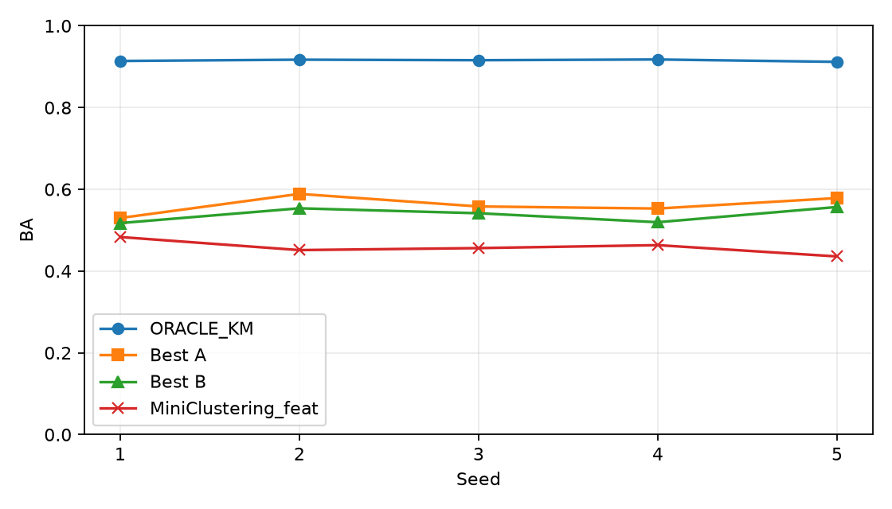
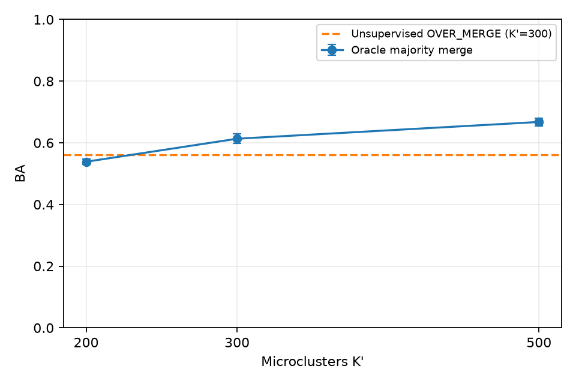

# 第三阶段经典方法排查报告

完成时间：2026-10-31T17:52:48+08:00（北京时间）；机器 RTX 5060 8GB。第三阶段只做冻结 DINOv2 特征上的诊断，不开发新方法。

## 1. 协议与输入

协议 SHA-256：`f2b298c369f2ce72687d55beeee9c6710675c00001ad4ab936206db695adce59`。第一阶段八个特征文件 SHA-256 与 `results/feature_manifest.json` 完全一致。沿用第一阶段子集构造与第二阶段评价函数；IR=100/10 的同条件同种子索引哈希逐项核对。
环境：Python 3.12.16，torch 2.11.0+cu128，NumPy 1.26.4，scikit-learn 1.4.0；未改动 torch/NumPy。CUBLAS_WORKSPACE_CONFIG=:4096:8；运行入口后期补入第二阶段 GPU deterministic 设置，关闭 cuDNN benchmark 与 TF32。早期 CPU 结果未经过这项 GPU 设置，但实际完成的聚类分支均在 CPU 上，不能把它们表述为 GPU 确定性实测。
第三方：DeepDPM 官方仓库 `https://github.com/BGU-CS-VIL/DeepDPM`，固定 commit `95c9376ac1b0cb48ea017c52d3abbf2a901940b3`，MIT；官方要求 torch 1.11/Lightning 1.2.10，原版入口在本机旧 Neptune 导入链中失败，且训练接口与新版框架差异超过最小修补。两个初始 K 均未运行，详见 `results_stage3/deepdpm_compatibility.json`。FINCH 官方仓库 `https://github.com/ssarfraz/FINCH-Clustering`，固定 commit `ab3b014ae30c0dd2eaa82ff37378e076ca21198a`，MIT；本地按第一邻居规则实现，但 reqK 的最近中心逐对合并及自动层级与官方实现不等价，不能当作官方 FINCH 成绩。最初克隆失败后才通过 raw HTTPS 获取源码，故流水线早期跳过理由仍记录“获取失败”，后续审查与兼容性调查见 `results_stage3/third_party_review.json`。源码文件的 Git blob 核验见 `results_stage3/source_manifest.json`。未将第三方源码复制进 `scripts/`，所以没有第三方源码 patch。
冒烟结果在 `results_stage3/smoke/`，不计入统计。协议哈希在运行中保持不变，但 frozen_at 是手工填入的时间，且协议漏列 vMF 数值界、FINCH 的 2000 点 silhouette 抽样等实现细节。运行过程中修复过评价/映射错误，旧结果隔离在 superseded 目录。故这是一项固定单点配置的诊断，不能声称严格预注册。
统计均为 5 个种子的均值 ± 总体标准差（ddof=0），除簇数、时间、内存外数值为 0–1。运行时间为单方法墙钟秒数；峰值内存为 Windows 进程 PeakWorkingSetSize（MiB）。归一化簇熵按实际输出簇（HDBSCAN“记错”包括噪声桶）计算。第二阶段 silhouette-KM 只引用已有指标，旧文件未记录的 ARI/熵/内存标“未测”，不补算。

## 2. A 组：已知 K

### CIFAR100 IR=100

| 方法 | ACC | BA | P²OT 尾召回 | 阶段一尾召回 | 多对一 BA | 多对一尾召回 | 多对一尾覆盖率 | 归一化簇熵 | 时间(s) | 峰值内存(MiB) |
| --- | ---: | ---: | ---: | ---: | ---: | ---: | ---: | ---: | ---: | ---: |
| GMM_diag (5/5) | 0.4777 ± 0.0118 | 0.4178 ± 0.0192 | 0.1447 ± 0.0311 | 0.1451 ± 0.0419 | 0.4426 ± 0.0075 | 0.0000 ± 0.0000 | 0.0000 ± 0.0000 | 0.9771 ± 0.0044 | 5.5651 ± 0.8433 | 675.0727 ± 0.4817 |
| vMF_free (5/5) | 0.4855 ± 0.0099 | 0.4141 ± 0.0129 | 0.1142 ± 0.0367 | 0.1234 ± 0.0221 | 0.4324 ± 0.0102 | 0.0000 ± 0.0000 | 0.0000 ± 0.0000 | 0.9670 ± 0.0023 | 20.5656 ± 2.2061 | 732.3250 ± 0.6005 |
| SC_knn (5/5) | 0.6105 ± 0.0098 | 0.5323 ± 0.0103 | 0.2606 ± 0.0234 | 0.2854 ± 0.0306 | 0.5353 ± 0.0064 | 0.0522 ± 0.0292 | 0.0600 ± 0.0327 | 0.9468 ± 0.0031 | 22.7740 ± 2.1801 | 4886.3867 ± 0.2256 |
| AGG_ward (5/5) | 0.5342 ± 0.0064 | 0.4587 ± 0.0150 | 0.1491 ± 0.0419 | 0.1743 ± 0.0396 | 0.4642 ± 0.0085 | 0.0000 ± 0.0000 | 0.0000 ± 0.0000 | 0.9720 ± 0.0029 | 2.9705 ± 0.2403 | 1524.1406 ± 0.3455 |
| AGG_avg_cos (5/5) | 0.6667 ± 0.0054 | 0.4493 ± 0.0127 | 0.3162 ± 0.0299 | 0.3230 ± 0.0258 | 0.4359 ± 0.0154 | 0.2316 ± 0.0249 | 0.3333 ± 0.0365 | 0.8089 ± 0.0089 | 11.6667 ± 0.7127 | 1500.5203 ± 0.2316 |
| OVER_MERGE (5/5) | 0.7173 ± 0.0107 | 0.5605 ± 0.0222 | 0.3086 ± 0.0388 | 0.3359 ± 0.0445 | 0.5579 ± 0.0224 | 0.2017 ± 0.0437 | 0.2467 ± 0.0581 | 0.8967 ± 0.0049 | 46.9194 ± 4.3339 | 665.3625 ± 0.1761 |
| FINCH_reqK (5/5) | 0.7138 ± 0.0096 | 0.5382 ± 0.0165 | 0.3469 ± 0.0288 | 0.3566 ± 0.0347 | 0.5351 ± 0.0256 | 0.2478 ± 0.0502 | 0.3467 ± 0.0618 | 0.8433 ± 0.0067 | 2.0128 ± 0.1891 | 1964.9336 ± 0.5999 |

### CIFAR100 IR=10

| 方法 | ACC | BA | P²OT 尾召回 | 阶段一尾召回 | 多对一 BA | 多对一尾召回 | 多对一尾覆盖率 | 归一化簇熵 | 时间(s) | 峰值内存(MiB) |
| --- | ---: | ---: | ---: | ---: | ---: | ---: | ---: | ---: | ---: | ---: |
| GMM_diag (5/5) | 0.5950 ± 0.0066 | 0.5642 ± 0.0103 | 0.3998 ± 0.0317 | 0.4141 ± 0.0346 | 0.5956 ± 0.0060 | 0.3197 ± 0.0240 | 0.3733 ± 0.0327 | 0.9667 ± 0.0036 | 9.2899 ± 1.0480 | 754.9930 ± 0.2549 |
| vMF_free (5/5) | 0.5917 ± 0.0100 | 0.5566 ± 0.0164 | 0.3990 ± 0.0409 | 0.4160 ± 0.0460 | 0.5805 ± 0.0074 | 0.2991 ± 0.0156 | 0.3667 ± 0.0211 | 0.9623 ± 0.0031 | 39.9764 ± 2.0763 | 855.2422 ± 0.7228 |
| SC_knn (5/5) | 0.7151 ± 0.0085 | 0.6711 ± 0.0090 | 0.5972 ± 0.0106 | 0.6091 ± 0.0183 | 0.6990 ± 0.0112 | 0.5660 ± 0.0298 | 0.6400 ± 0.0389 | 0.9436 ± 0.0017 | 97.4925 ± 8.4456 | 14455.9164 ± 144.4566 |
| AGG_ward (5/5) | 0.6389 ± 0.0112 | 0.6029 ± 0.0096 | 0.4522 ± 0.0208 | 0.4594 ± 0.0251 | 0.6197 ± 0.0091 | 0.3582 ± 0.0219 | 0.4333 ± 0.0211 | 0.9712 ± 0.0009 | 10.8711 ± 0.5369 | 3590.3344 ± 0.2999 |
| AGG_avg_cos (5/5) | 0.5455 ± 0.0047 | 0.4287 ± 0.0029 | 0.2993 ± 0.0148 | 0.2980 ± 0.0137 | 0.4258 ± 0.0065 | 0.2802 ± 0.0198 | 0.3800 ± 0.0267 | 0.8231 ± 0.0045 | 40.0293 ± 2.5397 | 3552.2234 ± 0.1850 |
| OVER_MERGE (5/5) | 0.6950 ± 0.0021 | 0.6414 ± 0.0084 | 0.5655 ± 0.0317 | 0.5753 ± 0.0273 | 0.6569 ± 0.0049 | 0.5345 ± 0.0198 | 0.7067 ± 0.0133 | 0.9276 ± 0.0040 | 95.9762 ± 5.2981 | 742.1227 ± 0.2154 |
| FINCH_reqK (5/5) | 0.6892 ± 0.0188 | 0.6141 ± 0.0265 | 0.4546 ± 0.0460 | 0.4721 ± 0.0535 | 0.6353 ± 0.0236 | 0.3952 ± 0.0565 | 0.4933 ± 0.0712 | 0.9394 ± 0.0038 | 2.9636 ± 0.0955 | 2175.2383 ± 0.2606 |

### CIFAR10 IR=100

| 方法 | ACC | BA | P²OT 尾召回 | 阶段一尾召回 | 多对一 BA | 多对一尾召回 | 多对一尾覆盖率 | 归一化簇熵 | 时间(s) | 峰值内存(MiB) |
| --- | ---: | ---: | ---: | ---: | ---: | ---: | ---: | ---: | ---: | ---: |
| GMM_diag (5/5) | 0.5738 ± 0.0264 | 0.4201 ± 0.0450 | 0.1547 ± 0.1529 | 0.1547 ± 0.1529 | 0.4512 ± 0.0642 | 0.0000 ± 0.0000 | 0.0000 ± 0.0000 | 0.9371 ± 0.0118 | 2.1719 ± 0.2491 | 688.2555 ± 0.4644 |
| vMF_free (5/5) | 0.5272 ± 0.0166 | 0.3497 ± 0.0080 | 0.0067 ± 0.0060 | 0.0067 ± 0.0060 | 0.4687 ± 0.0055 | 0.0000 ± 0.0000 | 0.0000 ± 0.0000 | 0.9288 ± 0.0018 | 3.8210 ± 0.5335 | 727.1969 ± 0.3207 |
| SC_knn (5/5) | 0.7745 ± 0.0546 | 0.6158 ± 0.0028 | 0.3151 ± 0.0366 | 0.3151 ± 0.0366 | 0.6905 ± 0.0006 | 0.3305 ± 0.0010 | 0.3333 ± 0.0000 | 0.8018 ± 0.0464 | 20.8484 ± 1.6299 | 6204.4578 ± 0.4558 |
| AGG_ward (5/5) | 0.5644 ± 0.0080 | 0.3685 ± 0.0038 | 0.0088 ± 0.0071 | 0.0088 ± 0.0071 | 0.4765 ± 0.0035 | 0.0000 ± 0.0000 | 0.0000 ± 0.0000 | 0.9231 ± 0.0067 | 3.5848 ± 0.1424 | 1807.4711 ± 0.1024 |
| AGG_avg_cos (5/5) | 0.8644 ± 0.0074 | 0.5274 ± 0.0659 | 0.0669 ± 0.1292 | 0.0669 ± 0.1292 | 0.4730 ± 0.0673 | 0.0651 ± 0.1301 | 0.0667 ± 0.1333 | 0.6567 ± 0.0139 | 15.0971 ± 0.3218 | 1781.6172 ± 0.2713 |
| OVER_MERGE (5/5) | 0.7252 ± 0.0356 | 0.6130 ± 0.0427 | 0.2801 ± 0.1283 | 0.2801 ± 0.1283 | 0.6710 ± 0.0563 | 0.1966 ± 0.1606 | 0.2000 ± 0.1633 | 0.8648 ± 0.0168 | 7.2918 ± 0.4068 | 678.8813 ± 0.2307 |
| FINCH_reqK (5/5) | 0.6938 ± 0.0206 | 0.5038 ± 0.0439 | 0.0761 ± 0.1264 | 0.0761 ± 0.1264 | 0.5698 ± 0.0642 | 0.0657 ± 0.1314 | 0.0667 ± 0.1333 | 0.8954 ± 0.0127 | 1.1605 ± 0.0585 | 2158.8523 ± 0.1931 |

### CIFAR100 IR=1

| 方法 | ACC | BA | P²OT 尾召回 | 阶段一尾召回 | 多对一 BA | 多对一尾召回 | 多对一尾覆盖率 | 归一化簇熵 | 时间(s) | 峰值内存(MiB) |
| --- | ---: | ---: | ---: | ---: | ---: | ---: | ---: | ---: | ---: | ---: |
| GMM_diag (5/5) | 0.6910 ± 0.0127 | 0.6910 ± 0.0127 | 0.6955 ± 0.0283 | 0.7188 ± 0.0329 | 0.7059 ± 0.0092 | 0.7235 ± 0.0144 | 0.9600 ± 0.0327 | 0.9664 ± 0.0040 | 19.0925 ± 5.6203 | 1067.2938 ± 40.4701 |
| vMF_free (5/5) | 0.6601 ± 0.0089 | 0.6601 ± 0.0089 | 0.6677 ± 0.0148 | 0.6794 ± 0.0088 | 0.6765 ± 0.0062 | 0.6907 ± 0.0236 | 0.9667 ± 0.0365 | 0.9607 ± 0.0026 | 96.1356 ± 21.0200 | 1294.3266 ± 40.0442 |
| OVER_MERGE (5/5) | 0.6717 ± 0.0027 | 0.6717 ± 0.0027 | 0.6945 ± 0.0336 | 0.6695 ± 0.0154 | 0.6963 ± 0.0021 | 0.7153 ± 0.0309 | 0.8933 ± 0.0249 | 0.9567 ± 0.0012 | 232.2498 ± 37.9653 | 1043.5523 ± 40.3618 |

### 主条件：最强经典 − MiniClustering_feat

| 指标 | 配对差均值 ± 标准差 | 正差 |
| --- | ---: | ---: |
| ACC | 0.1969 ± 0.0227 | 5/5 |
| balanced_accuracy | 0.1037 ± 0.0350 | 5/5 |
| head_recall | 0.2093 ± 0.0180 | 5/5 |
| medium_recall | -0.0104 ± 0.0732 | 2/5 |
| tail_recall | 0.1501 ± 0.0416 | 5/5 |
| stage1_tail_recall | 0.1673 ± 0.0494 | 5/5 |
| many_to_one_BA | 0.1045 ± 0.0217 | 5/5 |
| many_to_one_tail_recall | 0.2340 ± 0.0545 | 5/5 |
| tail_coverage | 0.3067 ± 0.0827 | 5/5 |

### 主条件：ORACLE_KM − 最强经典

| 指标 | 配对差均值 ± 标准差 | 正差 |
| --- | ---: | ---: |
| ACC | 0.1747 ± 0.0103 | 5/5 |
| balanced_accuracy | 0.3537 ± 0.0206 | 5/5 |

## 3. B 组：未知 K

### CIFAR100 IR=100

| 方法 | BA | P²OT 尾召回 | 多对一 BA | 多对一尾召回 | 多对一尾覆盖率 | 预测簇数 | 归一化簇熵 | 时间(s) | 峰值内存(MiB) |
| --- | ---: | ---: | ---: | ---: | ---: | ---: | ---: | ---: | ---: |
| HDBSCAN_error (5/5) | 0.3522 ± 0.0118 | 0.1486 ± 0.0154 | 0.3716 ± 0.0118 | 0.1328 ± 0.0199 | 0.2467 ± 0.0340 | 115.6000 ± 5.2383 | 0.6266 ± 0.0128 | 11.3923 ± 2.1967 | 674.5930 ± 0.2256 |
| HDBSCAN_nearest (5/5) | 0.5377 ± 0.0166 | 0.3144 ± 0.0321 | 0.5458 ± 0.0208 | 0.1460 ± 0.0391 | 0.1667 ± 0.0471 | 115.6000 ± 5.2383 | 0.9217 ± 0.0030 | 11.9438 ± 2.2760 | 1172.5008 ± 38.8830 |
| FINCH_auto (5/5) | 0.4217 ± 0.0165 | 0.1072 ± 0.0429 | 0.4127 ± 0.0123 | 0.0123 ± 0.0152 | 0.0133 ± 0.0163 | 68.6000 ± 3.6111 | 0.9472 ± 0.0053 | 1.0831 ± 0.0790 | 1964.7609 ± 0.4482 |
| Leiden_knn (5/5) | 0.3268 ± 0.0038 | 0.0249 ± 0.0185 | 0.3258 ± 0.0062 | 0.0098 ± 0.0121 | 0.0133 ± 0.0163 | 39.2000 ± 0.7483 | 0.9334 ± 0.0057 | 1.6151 ± 0.0554 | 1966.7703 ± 0.3610 |
| silhouette_KM (5/5) | 0.3266 ± 0.0157 | 0.0195 ± 0.0159 | 0.3267 ± 0.0271 | 0.0000 ± 0.0000 | 0.0000 ± 0.0000 | 50.0000 ± 10.9545 | 未测 | 49.2674 ± 0.0950 | 未测 |
| DeepDPM_init10/200 (0/5) | 未运行 | 未运行 | 未运行 | 未运行 | 未运行 | 未运行 | 未运行 | 未运行 | 未运行 |

### CIFAR100 IR=10

| 方法 | BA | P²OT 尾召回 | 多对一 BA | 多对一尾召回 | 多对一尾覆盖率 | 预测簇数 | 归一化簇熵 | 时间(s) | 峰值内存(MiB) |
| --- | ---: | ---: | ---: | ---: | ---: | ---: | ---: | ---: | ---: |
| HDBSCAN_error (5/5) | 0.4013 ± 0.0074 | 0.3524 ± 0.0106 | 0.4386 ± 0.0086 | 0.3689 ± 0.0165 | 0.8067 ± 0.0389 | 160.2000 ± 6.8819 | 0.5828 ± 0.0068 | 54.3125 ± 2.0200 | 755.2812 ± 0.2831 |
| HDBSCAN_nearest (5/5) | 0.6372 ± 0.0056 | 0.6185 ± 0.0199 | 0.7288 ± 0.0092 | 0.6463 ± 0.0232 | 0.7933 ± 0.0327 | 160.2000 ± 6.8819 | 0.9379 ± 0.0018 | 52.2830 ± 10.2480 | 2180.2438 ± 81.7553 |
| FINCH_auto (5/5) | 0.6074 ± 0.0256 | 0.4659 ± 0.0403 | 0.6505 ± 0.0225 | 0.3976 ± 0.0540 | 0.5000 ± 0.0632 | 113.6000 ± 1.7436 | 0.9494 ± 0.0017 | 3.0778 ± 0.0913 | 2175.5359 ± 0.1324 |
| Leiden_knn (5/5) | 0.4336 ± 0.0098 | 0.0994 ± 0.0326 | 0.4307 ± 0.0086 | 0.0921 ± 0.0258 | 0.1067 ± 0.0327 | 49.8000 ± 1.1662 | 0.9414 ± 0.0067 | 4.6356 ± 0.2673 | 2177.0102 ± 0.1720 |
| silhouette_KM (0/5) | 未运行 | 未运行 | 未运行 | 未运行 | 未运行 | 未运行 | 未运行 | 未运行 | 未运行 |
| DeepDPM_init10/200 (0/5) | 未运行 | 未运行 | 未运行 | 未运行 | 未运行 | 未运行 | 未运行 | 未运行 | 未运行 |

### CIFAR10 IR=100

| 方法 | BA | P²OT 尾召回 | 多对一 BA | 多对一尾召回 | 多对一尾覆盖率 | 预测簇数 | 归一化簇熵 | 时间(s) | 峰值内存(MiB) |
| --- | ---: | ---: | ---: | ---: | ---: | ---: | ---: | ---: | ---: |
| HDBSCAN_error (5/5) | 0.4778 ± 0.0657 | 0.6902 ± 0.0939 | 0.5634 ± 0.0493 | 0.7285 ± 0.0443 | 1.0000 ± 0.0000 | 76.0000 ± 20.9476 | 0.4087 ± 0.0285 | 12.6088 ± 0.6406 | 688.4422 ± 0.4410 |
| HDBSCAN_nearest (5/5) | 0.6497 ± 0.0776 | 0.8918 ± 0.0992 | 0.9559 ± 0.0136 | 0.9415 ± 0.0535 | 1.0000 ± 0.0000 | 76.0000 ± 20.9476 | 0.7841 ± 0.1065 | 13.2257 ± 0.4179 | 1195.8688 ± 244.0066 |
| FINCH_auto (5/5) | 0.3793 ± 0.1169 | 0.0681 ± 0.1323 | 0.4069 ± 0.1372 | 0.0657 ± 0.1314 | 0.0667 ± 0.1333 | 6.2000 ± 2.9257 | 0.9380 ± 0.0356 | 1.4781 ± 0.1120 | 2158.7859 ± 0.3385 |
| Leiden_knn (5/5) | 0.7420 ± 0.0480 | 0.9445 ± 0.0134 | 0.8523 ± 0.0666 | 0.6949 ± 0.2237 | 0.7333 ± 0.2494 | 23.6000 ± 0.8000 | 0.9203 ± 0.0075 | 1.8434 ± 0.0756 | 2160.5367 ± 0.3412 |
| silhouette_KM (0/5) | 未运行 | 未运行 | 未运行 | 未运行 | 未运行 | 未运行 | 未运行 | 未运行 | 未运行 |
| DeepDPM_init10/200 (0/5) | 未运行 | 未运行 | 未运行 | 未运行 | 未运行 | 未运行 | 未运行 | 未运行 | 未运行 |

### CIFAR100 IR=1

| 方法 | BA | P²OT 尾召回 | 多对一 BA | 多对一尾召回 | 多对一尾覆盖率 | 预测簇数 | 归一化簇熵 | 时间(s) | 峰值内存(MiB) |
| --- | ---: | ---: | ---: | ---: | ---: | ---: | ---: | ---: | ---: |
| HDBSCAN_error (5/5) | 0.3877 ± 0.0046 | 0.3808 ± 0.0099 | 0.4308 ± 0.0055 | 0.4142 ± 0.0117 | 0.8467 ± 0.0400 | 229.2000 ± 6.8235 | 0.5289 ± 0.0055 | 388.3995 ± 53.0787 | 1067.3828 ± 40.0552 |
| HDBSCAN_nearest (5/5) | 0.6167 ± 0.0073 | 0.6507 ± 0.0093 | 0.7788 ± 0.0108 | 0.7822 ± 0.0092 | 0.9267 ± 0.0133 | 229.2000 ± 6.8235 | 0.9348 ± 0.0034 | 374.4442 ± 57.8039 | 6825.2945 ± 259.1061 |
| FINCH_auto (5/5) | 0.6250 ± 0.0000 | 0.6295 ± 0.0000 | 0.8160 ± 0.0000 | 0.8250 ± 0.0000 | 1.0000 ± 0.0000 | 203.0000 ± 0.0000 | 0.9537 ± 0.0000 | 17.1188 ± 2.1973 | 2292.8891 ± 39.7532 |
| Leiden_knn (5/5) | 0.5723 ± 0.0104 | 0.5844 ± 0.0175 | 0.5723 ± 0.0104 | 0.5844 ± 0.0175 | 0.6267 ± 0.0249 | 63.4000 ± 1.4967 | 0.9520 ± 0.0020 | 25.4998 ± 2.2430 | 2314.5594 ± 40.2042 |
| silhouette_KM (5/5) | 0.6610 ± 0.0132 | 0.6811 ± 0.0334 | 0.6975 ± 0.0179 | 0.7241 ± 0.0325 | 0.9467 ± 0.0452 | 110.0000 ± 10.9545 | 未测 | 49.6467 ± 0.4182 | 未测 |
| DeepDPM_init10/200 (0/5) | 未运行 | 未运行 | 未运行 | 未运行 | 未运行 | 未运行 | 未运行 | 未运行 | 未运行 |

### 主条件：ORACLE_KM − B 组最高 BA 方法

| 指标 | 配对差均值 ± 标准差 | 正差 |
| --- | ---: | ---: |
| ACC | 0.2673 ± 0.0138 | 5/5 |
| balanced_accuracy | 0.3776 ± 0.0173 | 5/5 |

### HDBSCAN 原始噪声

| 条件 | 噪声点数 | 噪声占比 | 原始非噪声簇数 |
| --- | ---: | ---: | ---: |
| CIFAR100 IR=100 | 4715.2000 ± 147.2595 | 0.4347 ± 0.0136 | 115.6000 ± 5.2383 |
| CIFAR100 IR=10 | 9510.6000 ± 133.8680 | 0.4859 ± 0.0068 | 160.2000 ± 6.8819 |
| CIFAR10 IR=100 | 7030.4000 ± 1237.1741 | 0.5667 ± 0.0997 | 76.0000 ± 20.9476 |
| CIFAR100 IR=1 | 26402.2000 ± 349.3310 | 0.5280 ± 0.0070 | 229.2000 ± 6.8235 |

“噪声记错”时噪声样本永不映射为正确类别；“最近中心”将噪声分配给 PCA-128 欧氏最近的非噪声簇。早期最近中心日志的 raw_noise 被原地数组覆盖，原始噪声数量以对应的 HDBSCAN_error 结果为准，指标不受此日志错误影响。

### 预测簇数：CIFAR-100 IR=100 与 IR=1

| 方法 | IR=100 | IR=1 | IR=100 多对一尾覆盖 | IR=1 多对一尾覆盖 |
| --- | ---: | ---: | ---: | ---: |
| HDBSCAN_error | 115.6000 ± 5.2383 | 229.2000 ± 6.8235 | 0.2467 ± 0.0340 | 0.8467 ± 0.0400 |
| HDBSCAN_nearest | 115.6000 ± 5.2383 | 229.2000 ± 6.8235 | 0.1667 ± 0.0471 | 0.9267 ± 0.0133 |
| FINCH_auto | 68.6000 ± 3.6111 | 203.0000 ± 0.0000 | 0.0133 ± 0.0163 | 1.0000 ± 0.0000 |
| Leiden_knn | 39.2000 ± 0.7483 | 63.4000 ± 1.4967 | 0.0133 ± 0.0163 | 0.6267 ± 0.0249 |
| silhouette_KM | 50.0000 ± 10.9545 | 110.0000 ± 10.9545 | 0.0000 ± 0.0000 | 0.9467 ± 0.0452 |

## 4. C 组：超量聚类诊断

| K' | 多数类合并 BA | P²OT 尾召回 | 阶段一尾召回 | P²OT 尾覆盖率 | 阶段一尾覆盖率 | OVER_MERGE BA | BA 差 | 正差 |
| ---: | ---: | ---: | ---: | ---: | ---: | ---: | ---: | ---: |
| 200 | 0.5387 ± 0.0096 | 0.0540 ± 0.0205 | 0.0772 ± 0.0208 | 0.0667 ± 0.0298 | 0.0970 ± 0.0297 | 0.5605 ± 0.0222 | -0.0219 ± 0.0244 | 1/5 |
| 300 | 0.6133 ± 0.0161 | 0.2221 ± 0.0384 | 0.2541 ± 0.0419 | 0.2733 ± 0.0490 | 0.3212 ± 0.0562 | 0.5605 ± 0.0222 | 0.0527 ± 0.0130 | 5/5 |
| 500 | 0.6676 ± 0.0130 | 0.3655 ± 0.0519 | 0.3954 ± 0.0455 | 0.4933 ± 0.0533 | 0.5394 ± 0.0485 | 0.5605 ± 0.0222 | 0.1071 ± 0.0293 | 5/5 |

OVER_MERGE 合并前 K'=300：多对一 BA 0.6133 ± 0.0161，P²OT 尾召回 0.2221 ± 0.0384，尾覆盖率 0.2733 ± 0.0490；合并后尾覆盖率 0.2467 ± 0.0581。

### C 组完整指标与资源

| K' | ACC | NMI | ARI | macro F1 | 多对一 BA | 多对一尾召回 | 覆盖类数 | 预测簇数 | 归一化熵 | 时间(s) | 峰值内存(MiB) |
| ---: | ---: | ---: | ---: | ---: | ---: | ---: | ---: | ---: | ---: | ---: | ---: |
| 200 | 0.8306 ± 0.0024 | 0.7521 ± 0.0005 | 0.2992 ± 0.0019 | 0.5241 ± 0.0108 | 0.5387 ± 0.0096 | 0.0540 ± 0.0205 | 64.4000 ± 1.8547 | 200.0000 ± 0.0000 | 0.9806 ± 0.0005 | 25.9656 ± 0.0606 | 747.6609 ± 0.2908 |
| 300 | 0.8492 ± 0.0033 | 0.7370 ± 0.0025 | 0.2293 ± 0.0030 | 0.6062 ± 0.0150 | 0.6133 ± 0.0161 | 0.2221 ± 0.0384 | 74.0000 ± 1.6733 | 300.0000 ± 0.0000 | 0.9794 ± 0.0011 | 38.2075 ± 0.2086 | 747.4383 ± 0.3446 |
| 500 | 0.8605 ± 0.0014 | 0.7144 ± 0.0010 | 0.1562 ± 0.0020 | 0.6710 ± 0.0113 | 0.6676 ± 0.0130 | 0.3655 ± 0.0519 | 84.0000 ± 1.6733 | 500.0000 ± 0.0000 | 0.9765 ± 0.0011 | 63.4261 ± 0.4015 | 747.6508 ± 0.2347 |

| K' | 头部召回 | 中部召回 | 阶段一尾召回 | 阶段一尾覆盖率 |
| ---: | ---: | ---: | ---: | ---: |
| 200 | 0.8785 ± 0.0060 | 0.6474 ± 0.0199 | 0.0772 ± 0.0208 | 0.0970 ± 0.0297 |
| 300 | 0.8872 ± 0.0016 | 0.7012 ± 0.0181 | 0.2541 ± 0.0419 | 0.3212 ± 0.0562 |
| 500 | 0.8957 ± 0.0019 | 0.7232 ± 0.0126 | 0.3954 ± 0.0455 | 0.5394 ± 0.0485 |

## 5. 冻结规则判读

**规则 1：经典方法没有解决问题，主线有力成立。** A 组逐种子最优方法：['FINCH_reqK', 'OVER_MERGE', 'FINCH_reqK', 'OVER_MERGE', 'OVER_MERGE']；ORACLE_KM − 最强经典 BA：[0.3842, 0.3284, 0.3578, 0.3647, 0.3332]，均值 0.3537，≥0.30 为 5/5。
最强经典 − MiniClustering_feat BA：[0.0465, 0.1375, 0.1019, 0.0896, 0.1428]，均值 0.1037，正差 5/5。逐种子按真实标签取 A 组 BA 最大值，对经典方法有乐观偏向；只用于保守排查，不是可部署选择规则。
**规则 2：已运行 B 组的最优 BA 差满足 5/5，尾部退化已覆盖完整 B 组至少一半；DeepDPM 缺测使最终最优 BA 条件未定。** 已运行 B 组 ORACLE_KM − 最高 BA：[0.3966, 0.3636, 0.3744, 0.3982, 0.3551]，均值 0.3776，≥0.30 为 5/5。HDBSCAN 两种噪声处理计为同一方法，silhouette-KM 是旧阶段参照而非 B 组新方法；FINCH_auto 与 Leiden_knn 满足 IR=100 簇数≤80 或多对一尾覆盖≤0.10（完整四方法中 2/4，已达到一半）。FINCH_auto 从 K=68.6/尾覆盖 0.0133 变为 IR=1 的 K=203/尾覆盖 1.000；Leiden 从 K=39.2/尾覆盖 0.0133 变为 K=63.4/尾覆盖 0.6267。HDBSCAN 在 IR=100 预测 K=115.6，并非所有方法都低估 K，但其多对一尾覆盖仍低。DeepDPM 两个初始 K 都缺测；若其 BA 足够高，第一条件可能改变，因此完整结论未定。
规则 3：C 组只作描述性诊断，不设通过门槛。K'=300 的多数类映射 BA 0.6133，高于同一批微簇的无监督 OVER_MERGE BA 0.5605，配对差 +0.0527（5/5）；合并会造成损失。然而监督上限在 K'=300 时仍只覆盖约 27% 的 P²OT 尾类，K'=500 时增至约 49%、BA 增至 0.6676，表明微簇分离本身仍不足。综合看，困难以“分”为主，“合”也有可见损失；K'=200 与 K'=500 和 OVER_MERGE 的 K'=300 不同，差值只作描述，不能视为相同微簇上的纯合并效应。多数类映射使用真实标签，不能用于无监督部署。

### 综合结论

主线在冻结特征与本次 CIFAR 条件下成立；OVER_MERGE 是已验证的强经典基线（主条件 BA 0.5605），SC_knn 和本地 FINCH_reqK 也应列为对照。已运行的未知 K 方法表现符合长尾退化，但 DeepDPM 缺测且 FINCH 为非官方适配，完整“长尾 + 簇数未知”扩展未正式判定。超量聚类的证据支持先解决尾部微簇分离，再审视合并损失；这不是新方法建议，也不保证更高 K' 可部署。

### 完整指标附表

下列附表补充 NMI、ARI、宏 F1、头/中召回、两种尾部定义、覆盖类数和时间/内存；预测簇数及熵见上表。

### A 组补充：CIFAR100 IR=100

| 方法 | NMI | ARI | macro_F1 | 头部召回 | 中部召回 | 阶段一尾召回 | many_to_one_stage1_tail_recall | 覆盖类数 | 阶段一尾覆盖率 |
| --- | ---: | ---: | ---: | ---: | ---: | ---: | ---: | ---: | ---: |
| GMM_diag (5/5) | 0.7592 ± 0.0021 | 0.4064 ± 0.0135 | 0.3845 ± 0.0155 | 0.5082 ± 0.0170 | 0.5548 ± 0.0351 | 0.1451 ± 0.0419 | 0.0000 ± 0.0000 | 53.2000 ± 1.1662 | 0.0000 ± 0.0000 |
| vMF_free (5/5) | 0.7519 ± 0.0039 | 0.4009 ± 0.0169 | 0.3939 ± 0.0103 | 0.5037 ± 0.0175 | 0.5720 ± 0.0284 | 0.1234 ± 0.0221 | 0.0000 ± 0.0000 | 53.2000 ± 1.1662 | 0.0000 ± 0.0000 |
| SC_knn (5/5) | 0.8158 ± 0.0014 | 0.5441 ± 0.0097 | 0.4837 ± 0.0074 | 0.6528 ± 0.0094 | 0.6456 ± 0.0112 | 0.2854 ± 0.0306 | 0.0690 ± 0.0276 | 60.2000 ± 0.9798 | 0.0788 ± 0.0309 |
| AGG_ward (5/5) | 0.7789 ± 0.0032 | 0.4704 ± 0.0087 | 0.4263 ± 0.0101 | 0.5688 ± 0.0088 | 0.6083 ± 0.0375 | 0.1743 ± 0.0396 | 0.0090 ± 0.0115 | 55.6000 ± 1.0198 | 0.0121 ± 0.0148 |
| AGG_avg_cos (5/5) | 0.8134 ± 0.0034 | 0.6545 ± 0.0129 | 0.4108 ± 0.0187 | 0.6710 ± 0.0049 | 0.3829 ± 0.0299 | 0.3230 ± 0.0258 | 0.2463 ± 0.0315 | 56.2000 ± 1.4697 | 0.3515 ± 0.0454 |
| OVER_MERGE (5/5) | 0.8194 ± 0.0052 | 0.6549 ± 0.0128 | 0.5506 ± 0.0215 | 0.7529 ± 0.0136 | 0.6052 ± 0.0327 | 0.3359 ± 0.0445 | 0.2355 ± 0.0494 | 66.4000 ± 2.7276 | 0.2970 ± 0.0647 |
| FINCH_reqK (5/5) | 0.8283 ± 0.0059 | 0.6320 ± 0.0292 | 0.5309 ± 0.0199 | 0.7438 ± 0.0053 | 0.5275 ± 0.0224 | 0.3566 ± 0.0347 | 0.2635 ± 0.0517 | 64.8000 ± 2.9257 | 0.3758 ± 0.0562 |

### A 组补充：CIFAR100 IR=10

| 方法 | NMI | ARI | macro_F1 | 头部召回 | 中部召回 | 阶段一尾召回 | many_to_one_stage1_tail_recall | 覆盖类数 | 阶段一尾覆盖率 |
| --- | ---: | ---: | ---: | ---: | ---: | ---: | ---: | ---: | ---: |
| GMM_diag (5/5) | 0.7748 ± 0.0017 | 0.4583 ± 0.0240 | 0.5641 ± 0.0079 | 0.5951 ± 0.0077 | 0.6644 ± 0.0185 | 0.4141 ± 0.0346 | 0.3413 ± 0.0213 | 74.4000 ± 1.0198 | 0.4061 ± 0.0242 |
| vMF_free (5/5) | 0.7625 ± 0.0014 | 0.4602 ± 0.0124 | 0.5575 ± 0.0170 | 0.6044 ± 0.0132 | 0.6388 ± 0.0109 | 0.4160 ± 0.0460 | 0.3251 ± 0.0237 | 74.4000 ± 0.4899 | 0.4061 ± 0.0309 |
| SC_knn (5/5) | 0.8384 ± 0.0030 | 0.6191 ± 0.0133 | 0.6491 ± 0.0078 | 0.7888 ± 0.0119 | 0.6381 ± 0.0132 | 0.6091 ± 0.0183 | 0.5701 ± 0.0371 | 79.0000 ± 1.2649 | 0.6424 ± 0.0402 |
| AGG_ward (5/5) | 0.7936 ± 0.0035 | 0.5482 ± 0.0110 | 0.5972 ± 0.0096 | 0.6464 ± 0.0089 | 0.6833 ± 0.0138 | 0.4594 ± 0.0251 | 0.3727 ± 0.0340 | 76.6000 ± 0.8000 | 0.4545 ± 0.0332 |
| AGG_avg_cos (5/5) | 0.7765 ± 0.0024 | 0.4714 ± 0.0114 | 0.3751 ± 0.0035 | 0.6577 ± 0.0039 | 0.3540 ± 0.0100 | 0.2980 ± 0.0137 | 0.2809 ± 0.0177 | 58.0000 ± 2.0000 | 0.3758 ± 0.0242 |
| OVER_MERGE (5/5) | 0.8108 ± 0.0026 | 0.5771 ± 0.0085 | 0.6474 ± 0.0039 | 0.7608 ± 0.0096 | 0.6088 ± 0.0058 | 0.5753 ± 0.0273 | 0.5472 ± 0.0188 | 80.8000 ± 0.4000 | 0.7212 ± 0.0227 |
| FINCH_reqK (5/5) | 0.8155 ± 0.0069 | 0.5975 ± 0.0136 | 0.5985 ± 0.0276 | 0.7595 ± 0.0175 | 0.6246 ± 0.0359 | 0.4721 ± 0.0535 | 0.4180 ± 0.0635 | 75.8000 ± 3.1875 | 0.5212 ± 0.0752 |

### A 组补充：CIFAR10 IR=100

| 方法 | NMI | ARI | macro_F1 | 头部召回 | 中部召回 | 阶段一尾召回 | many_to_one_stage1_tail_recall | 覆盖类数 | 阶段一尾覆盖率 |
| --- | ---: | ---: | ---: | ---: | ---: | ---: | ---: | ---: | ---: |
| GMM_diag (5/5) | 0.6844 ± 0.0217 | 0.4691 ± 0.0296 | 0.3838 ± 0.0337 | 0.5603 ± 0.0421 | 0.5140 ± 0.0880 | 0.1547 ± 0.1529 | 0.0000 ± 0.0000 | 4.8000 ± 0.7483 | 0.0000 ± 0.0000 |
| vMF_free (5/5) | 0.6686 ± 0.0083 | 0.4180 ± 0.0114 | 0.3603 ± 0.0125 | 0.5233 ± 0.0309 | 0.4767 ± 0.0083 | 0.0067 ± 0.0060 | 0.0000 ± 0.0000 | 5.0000 ± 0.0000 | 0.0000 ± 0.0000 |
| SC_knn (5/5) | 0.8395 ± 0.0267 | 0.7482 ± 0.0865 | 0.6229 ± 0.0023 | 0.7504 ± 0.0462 | 0.7404 ± 0.0011 | 0.3151 ± 0.0366 | 0.3305 ± 0.0010 | 7.0000 ± 0.0000 | 0.3333 ± 0.0000 |
| AGG_ward (5/5) | 0.6835 ± 0.0066 | 0.4531 ± 0.0122 | 0.3722 ± 0.0021 | 0.5653 ± 0.0094 | 0.4908 ± 0.0038 | 0.0088 ± 0.0071 | 0.0000 ± 0.0000 | 5.0000 ± 0.0000 | 0.0000 ± 0.0000 |
| AGG_avg_cos (5/5) | 0.8314 ± 0.0098 | 0.8852 ± 0.0073 | 0.4854 ± 0.0651 | 0.8359 ± 0.0033 | 0.6414 ± 0.1021 | 0.0669 ± 0.1292 | 0.0651 ± 0.1301 | 5.2000 ± 0.7483 | 0.0667 ± 0.1333 |
| OVER_MERGE (5/5) | 0.7911 ± 0.0257 | 0.6645 ± 0.0392 | 0.6160 ± 0.0577 | 0.6857 ± 0.0409 | 0.8082 ± 0.1070 | 0.2801 ± 0.1283 | 0.1966 ± 0.1606 | 7.0000 ± 0.6325 | 0.2000 ± 0.1633 |
| FINCH_reqK (5/5) | 0.7583 ± 0.0271 | 0.5986 ± 0.0369 | 0.5148 ± 0.0524 | 0.6823 ± 0.0273 | 0.6908 ± 0.0124 | 0.0761 ± 0.1264 | 0.0657 ± 0.1314 | 6.0000 ± 0.6325 | 0.0667 ± 0.1333 |

### A 组补充：CIFAR100 IR=1

| 方法 | NMI | ARI | macro_F1 | 头部召回 | 中部召回 | 阶段一尾召回 | many_to_one_stage1_tail_recall | 覆盖类数 | 阶段一尾覆盖率 |
| --- | ---: | ---: | ---: | ---: | ---: | ---: | ---: | ---: | ---: |
| GMM_diag (5/5) | 0.7865 ± 0.0022 | 0.4640 ± 0.0221 | 0.7273 ± 0.0159 | 0.7195 ± 0.0363 | 0.6661 ± 0.0135 | 0.7188 ± 0.0329 | 0.7273 ± 0.0316 | 92.8000 ± 0.9798 | 0.9394 ± 0.0271 |
| vMF_free (5/5) | 0.7650 ± 0.0033 | 0.4299 ± 0.0120 | 0.6998 ± 0.0094 | 0.6817 ± 0.0141 | 0.6381 ± 0.0154 | 0.6794 ± 0.0088 | 0.6952 ± 0.0137 | 92.2000 ± 1.4697 | 0.9030 ± 0.0227 |
| OVER_MERGE (5/5) | 0.8024 ± 0.0017 | 0.5164 ± 0.0078 | 0.6717 ± 0.0028 | 0.6800 ± 0.0102 | 0.6484 ± 0.0229 | 0.6695 ± 0.0154 | 0.7234 ± 0.0231 | 87.6000 ± 0.8000 | 0.9273 ± 0.0148 |

### B 组补充：CIFAR100 IR=100

| 方法 | NMI | ARI | macro_F1 | 头部召回 | 中部召回 | 阶段一尾召回 | many_to_one_stage1_tail_recall | 覆盖类数 | 阶段一尾覆盖率 |
| --- | ---: | ---: | ---: | ---: | ---: | ---: | ---: | ---: | ---: |
| HDBSCAN_error (5/5) | 0.6256 ± 0.0090 | 0.0744 ± 0.0053 | 0.4205 ± 0.0149 | 0.4568 ± 0.0138 | 0.4264 ± 0.0183 | 0.1687 ± 0.0170 | 0.1547 ± 0.0220 | 65.8000 ± 2.1354 | 0.3030 ± 0.0271 |
| HDBSCAN_nearest (5/5) | 0.8001 ± 0.0026 | 0.6065 ± 0.0132 | 0.4848 ± 0.0144 | 0.6229 ± 0.0104 | 0.6413 ± 0.0233 | 0.3543 ± 0.0270 | 0.1924 ± 0.0409 | 62.8000 ± 3.0594 | 0.2242 ± 0.0492 |
| FINCH_auto (5/5) | 0.8015 ± 0.0053 | 0.5854 ± 0.0061 | 0.3743 ± 0.0126 | 0.7122 ± 0.0216 | 0.4397 ± 0.0080 | 0.1077 ± 0.0351 | 0.0150 ± 0.0128 | 47.0000 ± 1.4142 | 0.0182 ± 0.0148 |
| Leiden_knn (5/5) | 0.8244 ± 0.0046 | 0.6068 ± 0.0175 | 0.2858 ± 0.0058 | 0.7612 ± 0.0147 | 0.2274 ± 0.0113 | 0.0226 ± 0.0168 | 0.0089 ± 0.0110 | 35.4000 ± 0.4899 | 0.0121 ± 0.0148 |
| silhouette_KM (5/5) | 0.7673 ± 0.0025 | 未测 | 0.2977 ± 0.0191 | 0.7171 ± 0.0357 | 0.2639 ± 0.0507 | 0.0197 ± 0.0153 | 未测 | 38.0000 ± 3.0332 | 未测 |

### B 组补充：CIFAR100 IR=10

| 方法 | NMI | ARI | macro_F1 | 头部召回 | 中部召回 | 阶段一尾召回 | many_to_one_stage1_tail_recall | 覆盖类数 | 阶段一尾覆盖率 |
| --- | ---: | ---: | ---: | ---: | ---: | ---: | ---: | ---: | ---: |
| HDBSCAN_error (5/5) | 0.5973 ± 0.0057 | 0.0353 ± 0.0026 | 0.5013 ± 0.0073 | 0.4339 ± 0.0100 | 0.4135 ± 0.0159 | 0.3649 ± 0.0116 | 0.3800 ± 0.0153 | 88.6000 ± 1.8547 | 0.8242 ± 0.0353 |
| HDBSCAN_nearest (5/5) | 0.8010 ± 0.0014 | 0.5858 ± 0.0042 | 0.6539 ± 0.0065 | 0.6209 ± 0.0082 | 0.6634 ± 0.0183 | 0.6372 ± 0.0168 | 0.6632 ± 0.0223 | 87.8000 ± 0.4000 | 0.8121 ± 0.0297 |
| FINCH_auto (5/5) | 0.8063 ± 0.0066 | 0.5595 ± 0.0234 | 0.6006 ± 0.0263 | 0.6728 ± 0.0191 | 0.6646 ± 0.0266 | 0.4824 ± 0.0516 | 0.4201 ± 0.0621 | 78.2000 ± 2.9257 | 0.5273 ± 0.0707 |
| Leiden_knn (5/5) | 0.8113 ± 0.0036 | 0.5218 ± 0.0149 | 0.3716 ± 0.0123 | 0.7774 ± 0.0221 | 0.4263 ± 0.0317 | 0.1231 ± 0.0199 | 0.1052 ± 0.0203 | 47.6000 ± 1.3565 | 0.1212 ± 0.0271 |
| silhouette_KM (0/5) | 未运行 | 未运行 | 未运行 | 未运行 | 未运行 | 未运行 | 未运行 | 未运行 | 未运行 |

### B 组补充：CIFAR10 IR=100

| 方法 | NMI | ARI | macro_F1 | 头部召回 | 中部召回 | 阶段一尾召回 | many_to_one_stage1_tail_recall | 覆盖类数 | 阶段一尾覆盖率 |
| --- | ---: | ---: | ---: | ---: | ---: | ---: | ---: | ---: | ---: |
| HDBSCAN_error (5/5) | 0.4733 ± 0.0639 | 0.2389 ± 0.0849 | 0.5788 ± 0.0705 | 0.2593 ± 0.0976 | 0.4824 ± 0.0699 | 0.6902 ± 0.0939 | 0.7285 ± 0.0443 | 10.0000 ± 0.0000 | 1.0000 ± 0.0000 |
| HDBSCAN_nearest (5/5) | 0.6264 ± 0.0797 | 0.4841 ± 0.3063 | 0.6950 ± 0.0685 | 0.3679 ± 0.1348 | 0.6794 ± 0.0978 | 0.8918 ± 0.0992 | 0.9415 ± 0.0535 | 10.0000 ± 0.0000 | 1.0000 ± 0.0000 |
| FINCH_auto (5/5) | 0.7390 ± 0.0479 | 0.6463 ± 0.1188 | 0.3577 ± 0.1335 | 0.7477 ± 0.0877 | 0.3363 ± 0.2391 | 0.0681 ± 0.1323 | 0.0657 ± 0.1314 | 4.4000 ± 1.3565 | 0.0667 ± 0.1333 |
| Leiden_knn (5/5) | 0.6751 ± 0.0113 | 0.3010 ± 0.0152 | 0.7256 ± 0.0611 | 0.3659 ± 0.0080 | 0.8722 ± 0.1105 | 0.9445 ± 0.0134 | 0.6949 ± 0.2237 | 8.8000 ± 0.7483 | 0.7333 ± 0.2494 |
| silhouette_KM (0/5) | 未运行 | 未运行 | 未运行 | 未运行 | 未运行 | 未运行 | 未运行 | 未运行 | 未运行 |

### B 组补充：CIFAR100 IR=1

| 方法 | NMI | ARI | macro_F1 | 头部召回 | 中部召回 | 阶段一尾召回 | many_to_one_stage1_tail_recall | 覆盖类数 | 阶段一尾覆盖率 |
| --- | ---: | ---: | ---: | ---: | ---: | ---: | ---: | ---: | ---: |
| HDBSCAN_error (5/5) | 0.5709 ± 0.0040 | 0.0198 ± 0.0010 | 0.4945 ± 0.0072 | 0.3555 ± 0.0066 | 0.4170 ± 0.0015 | 0.3765 ± 0.0057 | 0.4443 ± 0.0053 | 94.8000 ± 1.9391 | 0.9818 ± 0.0242 |
| HDBSCAN_nearest (5/5) | 0.7953 ± 0.0013 | 0.5782 ± 0.0081 | 0.6833 ± 0.0139 | 0.5435 ± 0.0089 | 0.6462 ± 0.0168 | 0.5365 ± 0.0081 | 0.7598 ± 0.0149 | 94.8000 ± 1.9391 | 0.9212 ± 0.0242 |
| FINCH_auto (5/5) | 0.8077 ± 0.0000 | 0.5668 ± 0.0000 | 0.7064 ± 0.0000 | 0.5871 ± 0.0000 | 0.6500 ± 0.0000 | 0.5921 ± 0.0000 | 0.8267 ± 0.0000 | 100.0000 ± 0.0000 | 1.0000 ± 0.0000 |
| Leiden_knn (5/5) | 0.8249 ± 0.0023 | 0.4819 ± 0.0079 | 0.4912 ± 0.0157 | 0.5668 ± 0.0123 | 0.5673 ± 0.0255 | 0.5589 ± 0.0075 | 0.5589 ± 0.0075 | 63.4000 ± 1.4967 | 0.6364 ± 0.0000 |
| silhouette_KM (5/5) | 0.7810 ± 0.0070 | 未测 | 0.6802 ± 0.0202 | 0.6794 ± 0.0321 | 0.6320 ± 0.0293 | 0.6692 ± 0.0239 | 未测 | 91.6000 ± 3.8262 | 未测 |

## 6. 边界

只评估冻结特征、单一 DINOv2 骨干、CIFAR 与 5 个种子，超参是单点预设而非搜索。vMF 集中度用近似更新并限制在 100–10000，不是精确极大似然求解。IR=1 的 5 个种子选取相同的全部数据，不是 5 份独立样本。IR=1 的 SC 与层次聚类按资源限制未运行；CIFAR-100 IR=10 的谱聚类实际峰值约 14 GiB。DeepDPM 未运行，官方 FINCH 未逐行复现；这限制未知 K 结论。旧结果没有预测哈希，因此独立复跑只能核对完整指标、拟合记录与子集索引，不能追溯逐样本标签是否完全相同。完整性与复跑审计见 `results_stage3/integrity_audit.json`、`results_stage3/rerun_audit.json`。

