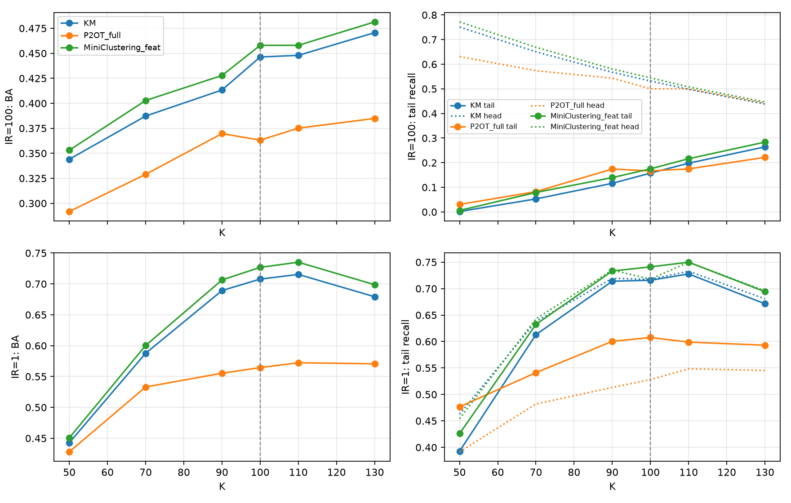

# 第二阶段长尾聚类诊断报告

生成日期：2026-10-31（北京时间）。本次只做诊断，不开发新方法。指标 0–1，标准差 ddof=0。

## 1. 冻结协议与判读

协议 SHA-256 `ee8aff58b27ed44b4bf560aa1f4697be991508cb14ab2786f80673427e38ec21`。流水线完成 232/232 项后生成本报告。

| 规则 | 均值差 | 正差 | 判读 |
| --- | ---: | ---: | --- |
| 1 ORACLE_KM − 最强特征方法 ≥0.10 | +0.4573 | 5/5 | 满足 |
| 2 TRUEPRIOR − P2OT_full ≥0.05 | -0.0075 | 2/5 | 不满足 |
| 3 K=70 尾部不对称下降，IR=1 不同样发生 | 见下表 | — | 满足 |

规则 1/2 还要求至少 4/5 严格正差；规则 3 的均值和逐种子条件按冻结协议执行。
规则 1 五个配对差：+0.4307, +0.4659, +0.4597, +0.4543, +0.4760。
规则 2 五个配对差：-0.0182, +0.0320, -0.0629, +0.0322, -0.0206。

## 2. 机器、数据与复现边界

本机 RTX 5060 8GB，驱动 610.88，CUDA 13.3（驱动显示），Python 3.12.16，torch 2.11.0+cu128（运行时 CUDA 12.8）。第一阶段为 GTX 1650 Ti。用户要求沿用本机已有 PyTorch，因此与原计划的 Python 3.9.21/torch 2.8.0 有版本偏差；基础旧环境未改。GPU sm_120 的确定性矩阵乘法与卷积均通过，TF32 和 cuDNN benchmark 关闭。
训练分支记录的最大 torch CUDA allocated 峰值 260.8 MiB（不含 CUDA 上下文和非 PyTorch 分配）；环境与依赖见 `environment_gpu_5060.txt`。
8/8 个特征文件 SHA-256 与第一阶段清单一致；30/30 个子集索引哈希一致；CIFAR-100 官方归档哈希 `85cd44d02ba6437773c5bbd22e183051d648de2e7d6b014e1ef29b855ba677a7` 一致。数据与第三方源码未提交。

## 3. 论文配置与本次差异

| 项目 | 原论文/官方代码 | 本次 |
| --- | --- | --- |
| P²OT 骨干 | DINO ViT-B/16，微调最后一个 block（附录 F.1） | 冻结 DINOv2 ViT-B/14 的 768 维 CLS；无法微调 block |
| P²OT 头与训练 | CIFAR100 两个余弦头；50 epoch，Adam，batch 512，lr 5e-4 余弦衰减；ε=0.1、λ/γ=1、ρ 从 0.1 sigmoid 升温，5120 logits memory bank | 保留两头、OT 求解器、日程、batch 与 bank；相同冻结特征作两视图 |
| P²OT 增强与选择 | Resize256/RandomCrop224、水平翻转、ColorJitter；按训练损失/ρ 选头和 epoch | 单次中心裁剪特征，无图像随机增强；仍按训练损失/ρ 选择 |
| TRUEPRIOR 诊断 | P²OT 原法每簇目标质量 ρ/K | 使用真实类别大小降序列表；在第 1 轮后按无标签预测簇占用量排序配给簇编号，之后固定，不提供哪簇对应哪一真实类 |
| MiniClustering 骨干 | ResNet-18，BYOL 同长尾数据预训练 800 epoch，随后 encoder 与双线性头联合训练 200 epoch | 冻结 DINOv2 特征，只训双线性头 200 epoch；无 BYOL、图像三视图及 encoder 更新 |
| MiniClustering 参数 | batch 512、Adam lr 1e-5、阈值 0.99；M、δ、α、β 随数据条件变化（附录 C） | M=2K、δ=0.3、α=β=1 预先固定；CIFAR100 细类没有原文对应配置 |
| MiniClustering_official | 论文表 1/2 是 CIFAR-10/20/STL-10 的 IR=5/10；CIFAR-20 是 CIFAR-100 超类 | 跳过 CIFAR-100 细类官方版：固定代码无该入口、存在 TabError，且需额外 800 epoch BYOL 预训练；不能声称原论文配置 |
| 许可证 | PPOT 固定 commit 含 CC BY-NC 4.0 LICENSE；MiniClustering 固定 commit 无 LICENSE | 仅本地诊断；不再分发第三方源码；运行只导入已审查的 PPOT 求解器 |

P²OT 论文正文写学习率衰减到 5e-6；固定代码的默认余弦调度实际 eta_min=5e-7，本次遵循代码默认值。P²OT 论文 ICLR 2024 表 1：CIFAR100-LT R=100 ACC 38.2±0.8%、NMI 69.6±0.3%、F1 32.0±0.9%。MiniClustering 论文 ICLR 2026 表 2：CIFAR-20 IR=10 ACC 44.3%、CAA 41.5%、NMI 47.2%、ARI 30.4%；附录表 6：CIFAR-10 IR=100 ACC 46.9%、CAA 44.6%、NMI 54.0%、ARI 34.6%。没有 CIFAR-100 细类论文数字。这些不同骨干和类别定义的成绩不作为直接复现阈值。

## 4. A/B 分支（均值 ± 标准差）

| 数据 | IR | 方法 | ACC | BA | NMI | macro-F1 | 头 | 中 | 尾 | 阶段一尾 |
| --- | ---: | --- | ---: | ---: | ---: | ---: | ---: | ---: | ---: | ---: |
| cifar100 | 100 | KM | 0.5123 ± 0.0133 | 0.4463 ± 0.0148 | 0.7741 ± 0.0031 | 0.4080 ± 0.0123 | 0.5319 ± 0.0147 | 0.5986 ± 0.0347 | 0.1577 ± 0.0329 | 0.1710 ± 0.0222 |
| cifar100 | 100 | ORACLE_KM | 0.8948 ± 0.0014 | 0.9153 ± 0.0022 | 0.8928 ± 0.0010 | 0.8553 ± 0.0059 | 0.8946 ± 0.0017 | 0.8906 ± 0.0024 | 0.9689 ± 0.0100 | 0.9630 ± 0.0106 |
| cifar100 | 100 | P2OT_full | 0.4589 ± 0.0177 | 0.3632 ± 0.0273 | 0.7272 ± 0.0085 | 0.3211 ± 0.0177 | 0.5002 ± 0.0243 | 0.4078 ± 0.0353 | 0.1666 ± 0.0460 | 0.1739 ± 0.0474 |
| cifar100 | 100 | P2OT_TRUEPRIOR | 0.5895 ± 0.0158 | 0.3557 ± 0.0237 | 0.7418 ± 0.0071 | 0.3373 ± 0.0216 | 0.6782 ± 0.0225 | 0.3232 ± 0.0517 | 0.0764 ± 0.0190 | 0.0844 ± 0.0232 |
| cifar100 | 100 | MiniClustering_feat | 0.5232 ± 0.0137 | 0.4580 ± 0.0155 | 0.7819 ± 0.0035 | 0.4140 ± 0.0123 | 0.5448 ± 0.0140 | 0.6050 ± 0.0355 | 0.1751 ± 0.0277 | 0.1865 ± 0.0222 |
| cifar100 | 100 | KM_ORACLE_INIT | 0.6843 ± 0.0097 | 0.6991 ± 0.0067 | 0.8134 ± 0.0037 | 0.6457 ± 0.0106 | 0.6990 ± 0.0081 | 0.7736 ± 0.0021 | 0.5999 ± 0.0150 | 0.6176 ± 0.0096 |
| cifar100 | 100 | P2OT_feat | 0.4712 ± 0.0089 | 0.3891 ± 0.0120 | 0.7631 ± 0.0045 | 0.3425 ± 0.0114 | 0.5159 ± 0.0184 | 0.4591 ± 0.0331 | 0.1690 ± 0.0107 | 0.1782 ± 0.0223 |
| cifar100 | 10 | KM | 0.6243 ± 0.0119 | 0.5866 ± 0.0179 | 0.7888 ± 0.0028 | 0.5781 ± 0.0177 | 0.6340 ± 0.0168 | 0.6824 ± 0.0172 | 0.4115 ± 0.0431 | 0.4322 ± 0.0489 |
| cifar100 | 10 | ORACLE_KM | 0.8793 ± 0.0008 | 0.8806 ± 0.0013 | 0.8781 ± 0.0009 | 0.8667 ± 0.0010 | 0.8860 ± 0.0011 | 0.8648 ± 0.0026 | 0.8964 ± 0.0036 | 0.8959 ± 0.0037 |
| cifar100 | 10 | P2OT_full | 0.5261 ± 0.0259 | 0.4737 ± 0.0215 | 0.7327 ± 0.0164 | 0.4473 ± 0.0217 | 0.5650 ± 0.0244 | 0.5326 ± 0.0321 | 0.3041 ± 0.0262 | 0.3182 ± 0.0251 |
| cifar100 | 10 | P2OT_TRUEPRIOR | 0.5651 ± 0.0225 | 0.4749 ± 0.0248 | 0.7347 ± 0.0220 | 0.4502 ± 0.0243 | 0.6430 ± 0.0224 | 0.5179 ± 0.0273 | 0.2496 ± 0.0319 | 0.2704 ± 0.0382 |
| cifar100 | 10 | MiniClustering_feat | 0.6372 ± 0.0119 | 0.5978 ± 0.0177 | 0.7985 ± 0.0020 | 0.5850 ± 0.0176 | 0.6492 ± 0.0162 | 0.6937 ± 0.0225 | 0.4185 ± 0.0408 | 0.4356 ± 0.0498 |
| cifar10 | 100 | KM | 0.5004 ± 0.0118 | 0.3486 ± 0.0062 | 0.6899 ± 0.0072 | 0.3607 ± 0.0101 | 0.4903 ± 0.0202 | 0.4873 ± 0.0034 | 0.0218 ± 0.0073 | 0.0218 ± 0.0073 |
| cifar10 | 100 | ORACLE_KM | 0.9830 ± 0.0005 | 0.9774 ± 0.0018 | 0.9437 ± 0.0013 | 0.9492 ± 0.0023 | 0.9859 ± 0.0004 | 0.9682 ± 0.0045 | 0.9810 ± 0.0090 | 0.9810 ± 0.0090 |
| cifar10 | 100 | P2OT_full | 0.5558 ± 0.0741 | 0.4636 ± 0.0716 | 0.6862 ± 0.0557 | 0.4255 ± 0.0896 | 0.5398 ± 0.0671 | 0.6142 ± 0.1787 | 0.1866 ± 0.0834 | 0.1866 ± 0.0834 |
| cifar10 | 100 | P2OT_TRUEPRIOR | 0.6512 ± 0.0359 | 0.4298 ± 0.0621 | 0.6403 ± 0.0526 | 0.4269 ± 0.0661 | 0.6414 ± 0.0477 | 0.5464 ± 0.1325 | 0.0628 ± 0.0532 | 0.0628 ± 0.0532 |
| cifar10 | 100 | MiniClustering_feat | 0.4978 ± 0.0082 | 0.3924 ± 0.0140 | 0.6936 ± 0.0012 | 0.3697 ± 0.0072 | 0.4834 ± 0.0103 | 0.4947 ± 0.0014 | 0.1651 ± 0.0363 | 0.1651 ± 0.0363 |

主条件配对差（逐种子原始值见 `paired_summary.json`）：

| 对比 | 指标 | 均差 ± 标准差 | 正差 |
| --- | --- | ---: | ---: |
| P2OT_TRUEPRIOR-P2OT_full | ACC | 0.1306 ± 0.0250 | 5/5 |
| P2OT_TRUEPRIOR-P2OT_full | NMI | 0.0146 ± 0.0134 | 4/5 |
| P2OT_TRUEPRIOR-P2OT_full | balanced_accuracy | -0.0075 ± 0.0360 | 2/5 |
| P2OT_TRUEPRIOR-P2OT_full | macro_F1 | 0.0161 ± 0.0259 | 4/5 |
| P2OT_TRUEPRIOR-P2OT_full | head_recall | 0.1780 ± 0.0344 | 5/5 |
| P2OT_TRUEPRIOR-P2OT_full | medium_recall | -0.0845 ± 0.0694 | 0/5 |
| P2OT_TRUEPRIOR-P2OT_full | tail_recall | -0.0903 ± 0.0481 | 0/5 |
| P2OT_TRUEPRIOR-P2OT_full | stage1_tail_recall | -0.0895 ± 0.0422 | 0/5 |
| P2OT_full-KM | ACC | -0.0534 ± 0.0253 | 0/5 |
| P2OT_full-KM | NMI | -0.0469 ± 0.0090 | 0/5 |
| P2OT_full-KM | balanced_accuracy | -0.0832 ± 0.0344 | 0/5 |
| P2OT_full-KM | macro_F1 | -0.0869 ± 0.0195 | 0/5 |
| P2OT_full-KM | head_recall | -0.0317 ± 0.0251 | 1/5 |
| P2OT_full-KM | medium_recall | -0.1908 ± 0.0426 | 0/5 |
| P2OT_full-KM | tail_recall | 0.0089 ± 0.0516 | 3/5 |
| P2OT_full-KM | stage1_tail_recall | 0.0029 ± 0.0521 | 2/5 |
| MiniClustering_feat-KM | ACC | 0.0109 ± 0.0016 | 5/5 |
| MiniClustering_feat-KM | NMI | 0.0077 ± 0.0010 | 5/5 |
| MiniClustering_feat-KM | balanced_accuracy | 0.0117 ± 0.0033 | 5/5 |
| MiniClustering_feat-KM | macro_F1 | 0.0060 ± 0.0015 | 5/5 |
| MiniClustering_feat-KM | head_recall | 0.0129 ± 0.0019 | 5/5 |
| MiniClustering_feat-KM | medium_recall | 0.0064 ± 0.0040 | 5/5 |
| MiniClustering_feat-KM | tail_recall | 0.0174 ± 0.0078 | 5/5 |
| MiniClustering_feat-KM | stage1_tail_recall | 0.0155 ± 0.0073 | 5/5 |
| ORACLE_KM-P2OT_full | ACC | 0.4359 ± 0.0178 | 5/5 |
| ORACLE_KM-P2OT_full | NMI | 0.1656 ± 0.0088 | 5/5 |
| ORACLE_KM-P2OT_full | balanced_accuracy | 0.5521 ± 0.0292 | 5/5 |
| ORACLE_KM-P2OT_full | macro_F1 | 0.5341 ± 0.0215 | 5/5 |
| ORACLE_KM-P2OT_full | head_recall | 0.3944 ± 0.0232 | 5/5 |
| ORACLE_KM-P2OT_full | medium_recall | 0.4828 ± 0.0371 | 5/5 |
| ORACLE_KM-P2OT_full | tail_recall | 0.8022 ± 0.0554 | 5/5 |
| ORACLE_KM-P2OT_full | stage1_tail_recall | 0.7891 ± 0.0562 | 5/5 |
| KM_ORACLE_INIT-ORACLE_KM | ACC | -0.2104 ± 0.0104 | 0/5 |
| KM_ORACLE_INIT-ORACLE_KM | NMI | -0.0794 ± 0.0041 | 0/5 |
| KM_ORACLE_INIT-ORACLE_KM | balanced_accuracy | -0.2162 ± 0.0077 | 0/5 |
| KM_ORACLE_INIT-ORACLE_KM | macro_F1 | -0.2096 ± 0.0123 | 0/5 |
| KM_ORACLE_INIT-ORACLE_KM | head_recall | -0.1956 ± 0.0081 | 0/5 |
| KM_ORACLE_INIT-ORACLE_KM | medium_recall | -0.1169 ± 0.0023 | 0/5 |
| KM_ORACLE_INIT-ORACLE_KM | tail_recall | -0.3690 ± 0.0230 | 0/5 |
| KM_ORACLE_INIT-ORACLE_KM | stage1_tail_recall | -0.3455 ± 0.0122 | 0/5 |
| P2OT_full-P2OT_feat | ACC | -0.0124 ± 0.0188 | 1/5 |
| P2OT_full-P2OT_feat | NMI | -0.0359 ± 0.0110 | 0/5 |
| P2OT_full-P2OT_feat | balanced_accuracy | -0.0259 ± 0.0186 | 0/5 |
| P2OT_full-P2OT_feat | macro_F1 | -0.0213 ± 0.0119 | 0/5 |
| P2OT_full-P2OT_feat | head_recall | -0.0157 ± 0.0188 | 1/5 |
| P2OT_full-P2OT_feat | medium_recall | -0.0513 ± 0.0252 | 0/5 |
| P2OT_full-P2OT_feat | tail_recall | -0.0023 ± 0.0402 | 1/5 |
| P2OT_full-P2OT_feat | stage1_tail_recall | -0.0043 ± 0.0371 | 3/5 |
| ORACLE_KM-MiniClustering_feat | ACC | 0.3715 ± 0.0133 | 5/5 |
| ORACLE_KM-MiniClustering_feat | NMI | 0.1109 ± 0.0042 | 5/5 |
| ORACLE_KM-MiniClustering_feat | balanced_accuracy | 0.4573 ± 0.0151 | 5/5 |
| ORACLE_KM-MiniClustering_feat | macro_F1 | 0.4413 ± 0.0177 | 5/5 |
| ORACLE_KM-MiniClustering_feat | head_recall | 0.3498 ± 0.0138 | 5/5 |
| ORACLE_KM-MiniClustering_feat | medium_recall | 0.2855 ± 0.0374 | 5/5 |
| ORACLE_KM-MiniClustering_feat | tail_recall | 0.7938 ± 0.0325 | 5/5 |
| ORACLE_KM-MiniClustering_feat | stage1_tail_recall | 0.7765 ± 0.0274 | 5/5 |

KM_ORACLE_INIT 收敛后 BA 相对 ORACLE_KM 为 -0.2162；P2OT_full 相对第一阶段简化 P2OT_feat 为 -0.0259。MiniClustering_official 未运行，因此不能给出与特征版的数值差。
与论文已报告数字作描述性比较：本次 CIFAR-100 IR=100 P2OT_full 的 ACC 均值相对论文表 1 的 0.382 为 +0.0769，NMI 相对 0.696 为 +0.0312；骨干、增强、微调和聚类评价设置均不同，不能解释为同协议复现误差。CIFAR-10 IR=100 的 MiniClustering_feat ACC 均值相对论文附录表 6 的 0.469 为 +0.0288，同样仅作描述。
归一化簇大小熵：真实 0.8702，ORACLE_KM 零次更新 0.8869，KM_ORACLE_INIT 收敛后 0.9348（1 表示完全均匀）。此比较结合 BA 差判断 Lloyd 目标是否改变长尾分配。
独立完整 P2OT_full 复跑预测哈希一致；KM CPU 复跑预测哈希一致，BA 绝对差 0.00000000、inertia 绝对差 0.00000000；ORACLE_KM 单独复算预测哈希一致，BA 绝对差 0.00000000。

## 5. K 敏感性

矩形 Hungarian 的未匹配类召回为 0；多对一评价将每簇映到多数类，用于区分拆分与合并。

| IR | 方法 | K | BA | 头召回 | 论文尾召回 | 阶段一尾召回 | 多对一 BA | 多对一尾召回 | 覆盖类数 | 尾覆盖 | NMI |
| ---: | --- | ---: | ---: | ---: | ---: | ---: | ---: | ---: | ---: | ---: | ---: |
| 100 | KM | 50 | 0.3441 ± 0.0075 | 0.7513 ± 0.0201 | 0.0019 ± 0.0024 | 0.0017 ± 0.0022 | 0.3425 ± 0.0062 | 0.0000 ± 0.0000 | 40.0000 ± 0.6325 | 0.0000 ± 0.0000 | 0.7816 ± 0.0057 |
| 100 | KM | 70 | 0.3873 ± 0.0158 | 0.6504 ± 0.0154 | 0.0529 ± 0.0235 | 0.0517 ± 0.0226 | 0.3900 ± 0.0143 | 0.0000 ± 0.0000 | 45.6000 ± 2.0591 | 0.0000 ± 0.0000 | 0.7788 ± 0.0028 |
| 100 | KM | 90 | 0.4133 ± 0.0183 | 0.5672 ± 0.0169 | 0.1163 ± 0.0196 | 0.1132 ± 0.0167 | 0.4338 ± 0.0121 | 0.0000 ± 0.0000 | 51.0000 ± 1.7889 | 0.0000 ± 0.0000 | 0.7760 ± 0.0035 |
| 100 | KM | 100 | 0.4463 ± 0.0148 | 0.5319 ± 0.0147 | 0.1577 ± 0.0329 | 0.1710 ± 0.0222 | 0.4471 ± 0.0109 | 0.0000 ± 0.0000 | 52.6000 ± 1.4967 | 0.0000 ± 0.0000 | 0.7741 ± 0.0031 |
| 100 | KM | 110 | 0.4480 ± 0.0180 | 0.4979 ± 0.0107 | 0.1979 ± 0.0403 | 0.2169 ± 0.0344 | 0.4664 ± 0.0113 | 0.0063 ± 0.0125 | 54.6000 ± 1.3565 | 0.0067 ± 0.0133 | 0.7722 ± 0.0024 |
| 100 | KM | 130 | 0.4707 ± 0.0064 | 0.4383 ± 0.0058 | 0.2643 ± 0.0303 | 0.2844 ± 0.0304 | 0.4975 ± 0.0199 | 0.0114 ± 0.0141 | 58.6000 ± 3.0067 | 0.0133 ± 0.0163 | 0.7664 ± 0.0020 |
| 100 | P2OT_full | 50 | 0.2918 ± 0.0100 | 0.6311 ± 0.0330 | 0.0305 ± 0.0311 | 0.0296 ± 0.0309 | 0.2956 ± 0.0030 | 0.0000 ± 0.0000 | 33.4000 ± 0.4899 | 0.0000 ± 0.0000 | 0.7129 ± 0.0082 |
| 100 | P2OT_full | 70 | 0.3290 ± 0.0127 | 0.5738 ± 0.0277 | 0.0826 ± 0.0228 | 0.0897 ± 0.0192 | 0.3387 ± 0.0112 | 0.0000 ± 0.0000 | 38.0000 ± 1.2649 | 0.0000 ± 0.0000 | 0.7260 ± 0.0128 |
| 100 | P2OT_full | 90 | 0.3697 ± 0.0161 | 0.5431 ± 0.0300 | 0.1744 ± 0.0399 | 0.1787 ± 0.0435 | 0.3780 ± 0.0115 | 0.0177 ± 0.0157 | 43.8000 ± 1.1662 | 0.0267 ± 0.0249 | 0.7344 ± 0.0063 |
| 100 | P2OT_full | 100 | 0.3632 ± 0.0273 | 0.5002 ± 0.0243 | 0.1666 ± 0.0460 | 0.1739 ± 0.0474 | 0.3885 ± 0.0208 | 0.0148 ± 0.0210 | 45.4000 ± 2.0591 | 0.0200 ± 0.0267 | 0.7272 ± 0.0085 |
| 100 | P2OT_full | 110 | 0.3751 ± 0.0180 | 0.4999 ± 0.0431 | 0.1749 ± 0.0329 | 0.1761 ± 0.0225 | 0.4058 ± 0.0153 | 0.0056 ± 0.0112 | 47.2000 ± 1.1662 | 0.0067 ± 0.0133 | 0.7372 ± 0.0099 |
| 100 | P2OT_full | 130 | 0.3849 ± 0.0164 | 0.4418 ± 0.0354 | 0.2216 ± 0.0476 | 0.2292 ± 0.0469 | 0.4202 ± 0.0041 | 0.0089 ± 0.0109 | 49.2000 ± 0.7483 | 0.0133 ± 0.0163 | 0.7343 ± 0.0041 |
| 100 | MiniClustering_feat | 50 | 0.3531 ± 0.0080 | 0.7719 ± 0.0214 | 0.0062 ± 0.0052 | 0.0057 ± 0.0047 | 0.3490 ± 0.0067 | 0.0000 ± 0.0000 | 39.6000 ± 0.4899 | 0.0000 ± 0.0000 | 0.7934 ± 0.0058 |
| 100 | MiniClustering_feat | 70 | 0.4028 ± 0.0136 | 0.6688 ± 0.0159 | 0.0792 ± 0.0266 | 0.0734 ± 0.0251 | 0.4012 ± 0.0128 | 0.0000 ± 0.0000 | 46.2000 ± 1.7205 | 0.0000 ± 0.0000 | 0.7888 ± 0.0022 |
| 100 | MiniClustering_feat | 90 | 0.4278 ± 0.0185 | 0.5808 ± 0.0176 | 0.1395 ± 0.0169 | 0.1363 ± 0.0173 | 0.4450 ± 0.0139 | 0.0000 ± 0.0000 | 51.6000 ± 2.0591 | 0.0000 ± 0.0000 | 0.7843 ± 0.0033 |
| 100 | MiniClustering_feat | 100 | 0.4580 ± 0.0155 | 0.5448 ± 0.0140 | 0.1751 ± 0.0277 | 0.1865 ± 0.0222 | 0.4567 ± 0.0077 | 0.0000 ± 0.0000 | 53.0000 ± 0.8944 | 0.0000 ± 0.0000 | 0.7819 ± 0.0035 |
| 100 | MiniClustering_feat | 110 | 0.4580 ± 0.0177 | 0.5080 ± 0.0113 | 0.2162 ± 0.0449 | 0.2317 ± 0.0387 | 0.4777 ± 0.0156 | 0.0124 ± 0.0152 | 55.2000 ± 1.7205 | 0.0133 ± 0.0163 | 0.7782 ± 0.0023 |
| 100 | MiniClustering_feat | 130 | 0.4814 ± 0.0088 | 0.4467 ± 0.0072 | 0.2837 ± 0.0207 | 0.3029 ± 0.0182 | 0.5047 ± 0.0192 | 0.0114 ± 0.0141 | 59.0000 ± 2.6077 | 0.0133 ± 0.0163 | 0.7720 ± 0.0028 |
| 1 | KM | 50 | 0.4428 ± 0.0043 | 0.4627 ± 0.0377 | 0.3927 ± 0.0295 | 0.4742 ± 0.0286 | 0.4428 ± 0.0043 | 0.3927 ± 0.0295 | 50.0000 ± 0.0000 | 0.4600 ± 0.0249 | 0.7434 ± 0.0039 |
| 1 | KM | 70 | 0.5877 ± 0.0042 | 0.6380 ± 0.0373 | 0.6130 ± 0.0407 | 0.6120 ± 0.0304 | 0.5881 ± 0.0041 | 0.6134 ± 0.0414 | 69.6000 ± 0.4899 | 0.7533 ± 0.0499 | 0.7807 ± 0.0018 |
| 1 | KM | 90 | 0.6892 ± 0.0097 | 0.7193 ± 0.0183 | 0.7140 ± 0.0344 | 0.7122 ± 0.0117 | 0.6969 ± 0.0089 | 0.7268 ± 0.0262 | 87.0000 ± 1.2649 | 0.9200 ± 0.0340 | 0.7975 ± 0.0034 |
| 1 | KM | 100 | 0.7078 ± 0.0088 | 0.7176 ± 0.0258 | 0.7158 ± 0.0223 | 0.7148 ± 0.0212 | 0.7236 ± 0.0056 | 0.7399 ± 0.0225 | 93.0000 ± 1.2649 | 0.9533 ± 0.0340 | 0.7995 ± 0.0017 |
| 1 | KM | 110 | 0.7154 ± 0.0088 | 0.7329 ± 0.0081 | 0.7278 ± 0.0150 | 0.7255 ± 0.0129 | 0.7539 ± 0.0081 | 0.7673 ± 0.0220 | 96.6000 ± 1.0198 | 0.9867 ± 0.0163 | 0.8030 ± 0.0037 |
| 1 | KM | 130 | 0.6792 ± 0.0097 | 0.6807 ± 0.0112 | 0.6713 ± 0.0217 | 0.6801 ± 0.0114 | 0.7652 ± 0.0082 | 0.7689 ± 0.0049 | 98.6000 ± 0.4899 | 0.9933 ± 0.0133 | 0.7980 ± 0.0027 |
| 1 | P2OT_full | 50 | 0.4281 ± 0.0065 | 0.3916 ± 0.0680 | 0.4765 ± 0.0479 | 0.3893 ± 0.0532 | 0.4304 ± 0.0060 | 0.4765 ± 0.0414 | 48.8000 ± 0.4000 | 0.5467 ± 0.0499 | 0.6503 ± 0.0168 |
| 1 | P2OT_full | 70 | 0.5331 ± 0.0158 | 0.4819 ± 0.0398 | 0.5412 ± 0.0343 | 0.4965 ± 0.0361 | 0.5463 ± 0.0146 | 0.5505 ± 0.0364 | 64.8000 ± 1.7205 | 0.6600 ± 0.0533 | 0.7015 ± 0.0086 |
| 1 | P2OT_full | 90 | 0.5554 ± 0.0322 | 0.5132 ± 0.0506 | 0.6003 ± 0.0146 | 0.5254 ± 0.0498 | 0.5938 ± 0.0247 | 0.6419 ± 0.0188 | 73.0000 ± 3.6332 | 0.7933 ± 0.0249 | 0.7071 ± 0.0131 |
| 1 | P2OT_full | 100 | 0.5645 ± 0.0203 | 0.5281 ± 0.0528 | 0.6076 ± 0.0350 | 0.5443 ± 0.0530 | 0.6186 ± 0.0158 | 0.6612 ± 0.0382 | 78.2000 ± 2.2271 | 0.8467 ± 0.0542 | 0.7215 ± 0.0057 |
| 1 | P2OT_full | 110 | 0.5723 ± 0.0260 | 0.5485 ± 0.0465 | 0.5989 ± 0.0552 | 0.5525 ± 0.0466 | 0.6447 ± 0.0223 | 0.6648 ± 0.0815 | 82.6000 ± 2.0591 | 0.8667 ± 0.0730 | 0.7308 ± 0.0121 |
| 1 | P2OT_full | 130 | 0.5706 ± 0.0131 | 0.5453 ± 0.0354 | 0.5930 ± 0.0280 | 0.5548 ± 0.0399 | 0.6802 ± 0.0162 | 0.7157 ± 0.0213 | 87.4000 ± 2.3324 | 0.9067 ± 0.0490 | 0.7447 ± 0.0077 |
| 1 | MiniClustering_feat | 50 | 0.4507 ± 0.0051 | 0.4541 ± 0.0467 | 0.4261 ± 0.0229 | 0.4606 ± 0.0426 | 0.4507 ± 0.0051 | 0.4261 ± 0.0229 | 50.0000 ± 0.0000 | 0.4867 ± 0.0163 | 0.7525 ± 0.0043 |
| 1 | MiniClustering_feat | 70 | 0.6003 ± 0.0053 | 0.6428 ± 0.0457 | 0.6323 ± 0.0362 | 0.6172 ± 0.0364 | 0.6007 ± 0.0053 | 0.6327 ± 0.0369 | 69.4000 ± 0.4899 | 0.7600 ± 0.0442 | 0.7925 ± 0.0029 |
| 1 | MiniClustering_feat | 90 | 0.7064 ± 0.0103 | 0.7349 ± 0.0191 | 0.7333 ± 0.0358 | 0.7278 ± 0.0114 | 0.7137 ± 0.0089 | 0.7452 ± 0.0266 | 87.2000 ± 1.1662 | 0.9200 ± 0.0340 | 0.8098 ± 0.0033 |
| 1 | MiniClustering_feat | 100 | 0.7269 ± 0.0089 | 0.7179 ± 0.0263 | 0.7411 ± 0.0187 | 0.7171 ± 0.0197 | 0.7423 ± 0.0054 | 0.7650 ± 0.0243 | 93.0000 ± 1.2649 | 0.9600 ± 0.0327 | 0.8128 ± 0.0016 |
| 1 | MiniClustering_feat | 110 | 0.7352 ± 0.0090 | 0.7499 ± 0.0105 | 0.7499 ± 0.0143 | 0.7424 ± 0.0149 | 0.7731 ± 0.0081 | 0.7897 ± 0.0213 | 96.8000 ± 1.1662 | 0.9867 ± 0.0163 | 0.8164 ± 0.0038 |
| 1 | MiniClustering_feat | 130 | 0.6987 ± 0.0105 | 0.6958 ± 0.0124 | 0.6943 ± 0.0210 | 0.6953 ± 0.0126 | 0.7833 ± 0.0091 | 0.7859 ± 0.0116 | 98.6000 ± 0.8000 | 0.9933 ± 0.0133 | 0.8097 ± 0.0029 |

K=70 相对 K=100 的配对下降：

| IR | 方法 | 尾部均降 | 头部均降 | 满足逐种子条件 | 判读 |
| ---: | --- | ---: | ---: | ---: | --- |
| 100 | KM | +0.1048 | -0.1185 | 5/5 | 满足 |
| 100 | P2OT_full | +0.0841 | -0.0736 | 2/5 | 不满足 |
| 1 | KM | +0.1028 | +0.0796 | 1/5 | 不满足 |
| 1 | P2OT_full | +0.0664 | +0.0462 | 1/5 | 不满足 |

逐种子 K=100 减 K=70 召回差（尾/头）：

- IR=100 KM: +0.1851/-0.1268, +0.0939/-0.1225, +0.0550/-0.1330, +0.0854/-0.1051, +0.1045/-0.1052
- IR=100 P2OT_full: +0.1301/-0.0592, +0.0467/-0.1084, +0.0371/-0.0467, +0.0444/-0.1113, +0.1620/-0.0425
- IR=1 KM: +0.0555/+0.0895, +0.1101/+0.0547, +0.1157/+0.0838, +0.1228/+0.0691, +0.1097/+0.1011
- IR=1 P2OT_full: +0.0766/+0.0551, +0.1597/+0.0341, +0.0077/+0.0587, +0.0469/+0.0630, +0.0410/+0.0200

## 6. 无标签 K 估计

在 L2 特征上用欧氏距离，固定 2000 点和 K=20..200（步长 10）最大 silhouette 选择。

| IR | seed1 | seed2 | seed3 | seed4 | seed5 | K 均值 | 聚类 BA | 聚类 NMI |
| ---: | ---: | ---: | ---: | ---: | ---: | ---: | ---: | ---: |
| 100 | 50 | 50 | 70 | 40 | 40 | 50.0 | 0.3266 ± 0.0157 | 0.7673 ± 0.0025 |
| 1 | 110 | 120 | 110 | 120 | 90 | 110.0 | 0.6610 ± 0.0132 | 0.7810 ± 0.0070 |

IR=100 的估计 K 均值相对 IR=1 为 -60.0；此处只作描述性比较，没有预设显著性门槛。

## 7. 判断边界

单一 DINOv2 骨干、以冻结特征为主、无法复现图像随机增强、仅 CIFAR、5 个配对种子。ORACLE_KM 使用真实类中心且零次 Lloyd 更新，只是受监督诊断参照，不是数学上界；KM_ORACLE_INIT 使用真实中心作初始化。TRUEPRIOR 使用真实类大小，未告知簇和类的对应关系，不能用于部署。IR=1 的五个种子共用完整数据集，不是五个独立样本。MiniClustering_feat 无原论文 CIFAR100 细类配置，其成绩只表明这一冻结特征适配的行为。

完整逐种子结果、训练损失、配对差、silhouette 曲线数据和运行日志位于 `results_stage2/`。所有负结果与偏差均保留。

## 参考来源

- Zhang, Ren, He. [P²OT: Progressive Partial Optimal Transport for Deep Imbalanced Clustering](https://openreview.net/forum?id=hD3sGVqPsr), ICLR 2024，表 1 与附录 F.1。
- Li et al. [Mini-cluster Guided Long-tailed Deep Clustering](https://openreview.net/forum?id=3JlljaiQwR), ICLR 2026，表 1/2、附录表 6 与附录 C。
- 第一阶段冻结协议和结果：`results/protocol.json`、`results/full/`；第三方固定 commit 与审查见 `results_stage2/third_party_review.json`。
