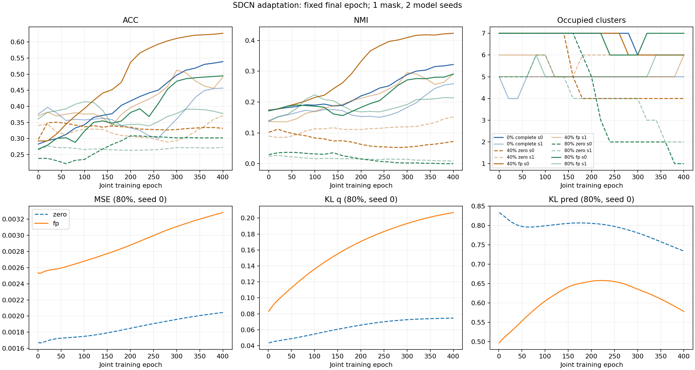

# 属性缺失图鲁棒聚类：第二阶段验证报告

日期：2026-10-22。范围：Cora 上 SDCN 适配基线校准、AMGC 官方论文与代码核查。原方向规划保持原样。

## 1. 当前判断

**可以继续这个方向：现有 CPU 环境已经能够完成数据处理、缺失构造、传播、深度聚类训练和评估。但稳定基线与 AMGC 运行验证还未过关，当前不能承诺创新点有效或论文成果。**

本阶段已完成 10 组主校准配置，训练累计 405.2 秒，约 6.8 分钟。FP 式传播在本次固定掩码、两个模型种子下均优于填零；与此同时，完整属性基线也只产生 5–6 个有效簇，80% 缺失填零出现明显簇塌缩。因此，应继续校准并跑直接相关方法 AMGC，暂不堆叠新的置信度模块或扩大正式实验矩阵。

## 2. 本轮解决了什么

- 原冒烟脚本的 AE 每轮只有一次全批更新；官方预训练使用 batch 256，Cora 每轮约 11 次更新。只比较 epoch 数会误判训练预算。本轮改为分批预训练，并分别记录预训练与联合训练。
- 缺失掩码与模型种子独立；同一缺失率、同一 mask 的 zero/FP 和不同模型种子共享掩码，并保存 SHA256。
- 保存 AE 初始 KMeans、最终 q 与 pred 分支预测、损失、簇占用及最后 20 轮预测变化，便于识别“损失有限但聚类塌缩”。
- 指标从保存的预测重新计算；10 组均通过预测、掩码、一跳冷启动定义及有限损失核验。子集 ACC 使用全图同一个 Hungarian 映射，评估不修改预测数组。
- 已获取正确的 FP、SDCN、AMGC 论文以及相关官方代码。AMGC 尚未运行，具体核查见[AMGC 复现核查](AMGC复现核查.md)。

## 3. 实验协议

| 项目 | 本轮设置 |
|---|---|
| 数据 | Cora Planetoid：2708 节点、1433 维、7 类；使用原图，无向处理 |
| 环境 | Python 3.9.21；PyTorch 2.8.0+cpu；NumPy 1.26.4；4 线程 |
| 缺失 | 随机节点整条属性缺失；0%、40%、80%；每个缺失率 1 个 mask |
| 随机性 | mask_seed=20261022；模型种子 0、1；mask 由缺失率与 mask 序号共同确定 |
| 输入 | 完整属性仅 complete；非零缺失分别 zero、FP 式传播 40 步 |
| 模型 | AE 编码 1433→128→64→10、对称解码；GCN 与 AE 交互；已知簇数 K=7 |
| 预训练 | 100 epochs；batch 256；Adam lr=0.001；KMeans n_init=20 初始化中心 |
| 联合训练 | 全批 400 epochs；Adam lr=0.0001；MSE + 0.1 KL(q) + 0.01 KL(pred)；每轮更新 DEC 目标 |
| 输出 | 统一报告固定最终轮 pred 分支；每 20 轮诊断；不按标签选最好 epoch |
| 标签用途 | 已知 K 的聚类设定；节点标签仅用于诊断评估，不输入训练目标 |

这是 **SDCN 诊断适配**。正确 SDCN 原文使用 d–500–500–2000–10、AE 30 轮、batch 256，图数据联合训练 50 轮，且原文没有 Cora 实验。本轮小模型和 100/400 预算均不是“官方 Cora 配置复现”。官方宽度可由脚本 `--hidden 500,500,2000` 指定，尚未执行。数据预处理、图构造和学习率也需在正式对照时明确。

FP 本地实现使用带自环的对称归一化邻接、迭代传播并恢复观测属性。迭代形式与官方相近，边/自环协议未完全核齐，故称 FP 式传播，不声称严格复现。第一阶段为 5 步，本轮为 40 步；两阶段不能仅按方法名直接比较。

## 4. 主校准结果

以下为两个模型种子的均值 ± 样本标准差（ddof=1），不是置信区间，也不包含多掩码方差。

| 缺失率 | 输入 | ACC | NMI | ARI | 缺失节点 ACC | 一跳冷启动 ACC | 有效簇，seed 0/1 |
|---:|---|---:|---:|---:|---:|---:|---|
| 0% | complete | 0.4980 ± 0.0582 | 0.2906 ± 0.0443 | 0.2191 ± 0.0376 | — | — | 6 / 5 |
| 40% | zero | 0.3516 ± 0.0277 | 0.1118 ± 0.0561 | 0.0696 ± 0.0198 | 0.3453 ± 0.0353 | 0.2623 ± 0.0464 | 4 / 6 |
| 40% | FP | 0.5591 ± 0.0961 | 0.3571 ± 0.0930 | 0.2998 ± 0.0872 | 0.5605 ± 0.0666 | 0.5082 ± 0.0116 | 6 / 6 |
| 80% | zero | 0.2873 ± 0.0209 | 0.0044 ± 0.0063 | 0.0013 ± 0.0018 | 0.2920 ± 0.0095 | 0.3186 ± 0.0000 | 1 / 2 |
| 80% | FP | 0.4363 ± 0.0828 | 0.2522 ± 0.0545 | 0.1716 ± 0.1068 | 0.4351 ± 0.0859 | 0.4114 ± 0.0940 | 7 / 6 |

逐种子 ACC：complete 0.5391/0.4568；40% zero 0.3320/0.3711，FP 0.6270/0.4911；80% zero 0.3021/0.2725，FP 0.4948/0.3778。

结果支持在这组诊断设置中继续研究传播与聚类的关系；只有一个 mask，尚不能推广到普遍鲁棒性或统计显著优势。40% FP 高于完整属性参照，可能涉及扩散正则化和优化差异。完整属性参照不是理论上界。

### 尚未通过的稳定性检查

1. **簇塌缩**：80% zero、seed 0 最终全部归入一个簇，NMI=ARI=0；ACC=0.3021 来自多数类占比。预测变化为零在这里不代表有用的收敛。
2. **完整属性基座仍需校准**：complete 也只占用 5–6 个簇，不能把所有退化都归于属性缺失。有效簇数是诊断信号，并非强制每次必须占满 7 簇的充分判据。
3. **末段仍有波动**：FP 在 40% 缺失时，最后 20 轮预测变化约为 0.92%/5.80%；80% 为 2.03%/7.72%。不宜声称均已稳定收敛。
4. **损失不能单独定论**：AE 预训练 MSE 下降；联合训练中 MSE、KL(q) 可上升，DEC 目标也在变化。不能要求各分量机械单调，更不能只看总损失就认定聚类正确。



## 5. 冷启动不等于传播完全不可达

本轮使用多源 BFS 从所有观测节点计算图距离，得到：

| 缺失率 | 缺失节点 | 无直接观测邻居 | 其中多跳可达 | 完全不可达的缺失节点 | 可达节点最远观测距离 |
|---:|---:|---:|---:|---:|---:|
| 40% | 1083 | 122 | 106 | 16 | 3 |
| 80% | 2166 | 1061 | 960 | 101 | 7 |

完全不可达表示所在连通分量没有任何观测节点；从零初始化的纯扩散不能凭空为这些节点生成属性信号。多跳可达的节点仍可能受到衰减、混合和结构质量影响，但不能称为传播一定失败。这修正了第一轮“无观测邻居即传播无法覆盖”的过强表述。

## 6. 下一步按这个顺序做

### A. 小范围校准 SDCN，先解释不稳定来源

先用已有 AE/q/pred 指标定位性能变化，再比较小模型与官方宽度适配，以及少量预先列出的学习率/预算设置；不要只延长 epoch。优先完整属性和一个高缺失设置，用相同掩码与至少三个模型种子诊断。记录实际优化更新次数、簇占用、最大簇占比和末段预测变化。标签只用于诊断；如果根据标签结果做开发选择，应明确其探索性质，正式评估使用预先固定协议和新的随机掩码。

通过条件：训练数值有限、结果可重复；基座不持续严重塌缩；训练末段变化与指标趋势能够解释。可预先将末 20 轮预测变化低于 1% 作为观察目标，但不能把它单独当作收敛证明。若仍不稳定，应优先排查实现、输入尺度、初始化和优化，不扩大完整矩阵。

### B. 在隔离环境做 AMGC 运行验证

已核对官方全文和仓库。接着为 AMGC 准备单独环境，先确认实际导入与必需算子，不修改现有 pytorch 环境。先跑 Cora 的 **60% 缺失（观测率 0.4）**、20–50 轮冒烟，检查损失、张量形状、预测、内存和每轮时间；通过后再做完整训练。CPU 是否能接受要实测，不能从 SDCN 的速度推断。若失败，保留日志并先定位依赖/实现问题。

在独立工作副本明确修正随机种子入口和评估副作用，保留原始预测；原版与修正后的结果分开标注。论文边遮蔽 0.7 与代码写死 0.5 的差异单列配置。与 SDCN 正式比较时共享同一缺失掩码、评估映射与缺失率定义。详见[核查与运行前清单](AMGC复现核查.md)。

### C. 稳定以后再扩大重复与检验创新

固定协议后进行 5 个 mask × 3 个模型种子，分清掩码与模型随机性，再扩 CiteSeer 等数据和低度节点优先缺失等模式。先看置信度是否能预测真实补全误差或聚类稳定性，再决定是否实现加权与历史门控。隐藏属性真值只用于离线诊断，不进入实际方法的置信度计算。

若基线稳定后新增置信度仍不能识别错误、或消融没有稳定收益，应调整研究假设，而不是凭规划中的叙述继续堆模块。现阶段没有证据支持“全球首次”或“错误反馈必然存在”。

## 7. 文件、复现与资料修正

- [训练脚本](run_sdcn_baseline.py)、[汇总核验脚本](summarize_stage2.py)。汇总核验已执行，10 组通过。
- [配置](sdcn_calibration_100_400/config.json)、[逐次结果](sdcn_calibration_100_400/results.csv)、[汇总](sdcn_calibration_100_400/summary.csv)、[核验结果](sdcn_calibration_100_400/verification.json)。每配置目录含 loss.csv、metrics.csv、result.json、predictions.npz、model.pt。
- [来源与哈希清单](stage2_manifest.json)、[清单生成脚本](build_stage2_manifest.py)。清单列出本地文件实际哈希和原始下载日志的修正，不把历史下载成功当成内容正确。

本轮命令（重跑须改输出目录名；脚本拒绝覆盖已有目录）：

```powershell
$env:OMP_NUM_THREADS='4'
$env:MKL_NUM_THREADS='4'
$env:OPENBLAS_NUM_THREADS='4'
& 'F:\Anaconda\envs\pytorch\python.exe' 'F:\研究生毕设\可行性验证\run_sdcn_baseline.py' --rates 0,0.4,0.8 --seeds 0,1 --pretrain-epochs 100 --train-epochs 400 --output sdcn_calibration_repeat
```

资料核对发现原 `sdcn.pdf` 错下成 arXiv:2004.10417 的数学论文，现已移至 `rejected_arxiv_2004.10417.*` 并弃用；正确 SDCN 全文为 [arXiv:2002.01633](https://arxiv.org/abs/2002.01633)，现已保存在 [sdcn.pdf](references/sdcn.pdf)，11 页。此前 SDCN 实验依据官方代码；本报告的论文参数核对依据修正后的全文。

AMGC 的 OpenReview HTML 是挑战页，PDF 入口返回过 403，均不作为全文证据。现已从 [AAAI 正式出版入口](https://doi.org/10.1609/aaai.v38i14.29464)取得有效 10 页 [amgc.pdf](references/amgc.pdf)。FP 全文为 [arXiv:2111.12128](https://arxiv.org/abs/2111.12128)。
